# Results measured so far

Everything below was produced by the code in this repository on a machine with **4 CPU cores and no GPU**.
The runs are therefore small: 3,000 optimisation steps, models of 5–17 M parameters, **one seed**, test sets of
240 (SynthWorld) and 460 (Flickr8k subset) caption groups. With 240 utterances a difference of fewer than about
8 points between two rows is within noise. The numbers show that the pipeline runs end to end and which
mechanisms have an effect in a controlled setting. They are **not** the numbers of a paper: those need the GPU
schedule in `scripts/paper_experiments.sh` (full data, three seeds, significance tests).

Sections 1–3 are generated from the JSON files under `runs/` by

```bash
python scripts/make_results.py --synth runs/sf_main --ablation runs/sf_ablation --real runs/f1200
```

## 0. What the runs show

**Works (SynthWorld, reference run = full model).**

- *Zero-pair speech translation of an unwritten, tonal language.* With 205 image–speech bridge pairs, no text of
  the island language and no parallel sentence anywhere in training, island speech → hub-language text reaches
  BLEU 22.4, and the first-mentioned object's shape word is right in 94 % of utterances.
- *Tone survives, and only where it is lexical.* Tone-contrastive (colour) words are translated correctly in
  81 % of island utterances and in 47.5 % when the pitch contour is removed from the input; scaling the contour
  from 0 to 1 moves that accuracy monotonically from 43 % to 83 % (96 utterances). The learned gate is 0.58 for the tonal
  language and 0.00 for the non-tonal one, whose accuracy (99 %) does not react to pitch at all.
- *Zero-pair text translation across scripts.* Latin-script hub language ↔ Devanagari-script language, with no
  pair of sentences ever shown together: 62 % and 68 % exact content, BLEU 43 and 51.
- *A plain ODE cycle is vacuous.* Its loss falls from 2.8 to 0.0002 as the solver goes from 1 to 32 steps, for the
  same weights (`09_ode_steps.png`): it measures the integrator, not alignment.

**What the ablations say** (section 2; one seed).

- *Sentence-level visual hub vs scene-level visual pivot:* the pivot loses on every translation and retrieval
  column (for example island content 12 % vs 28 %, text → third-language text 17 % vs 62 %).
- *Visual hub vs text anchor:* the text anchor is **better** when the target is hub-language text (island content
  41 % vs 28 %) and much worse for the third language (24 % vs 62 %) and for anything involving images. The claim
  that survives is "balanced across directions and not centred on one written language", not "better everywhere".
- *Tone stream:* without it, tone-word accuracy on the island falls from 81 % to 56 %, exactly its level with the
  pitch removed, island BLEU from 22 to 15 and island speech → image R@1 from 25 % to 13 %; the non-tonal hub
  language is unaffected (speech → text content 48 % vs 52 %).
- *Private tokens:* making the spokes deterministic costs 26 points of hub-language speech → text content
  accuracy (25 % vs 52 %) and 37 points of text → third-language content (25 % vs 62 %).
- *Transitive hub-swap:* removing it costs 17 points of hub-language speech → text content accuracy (35 % vs
  52 %; WER 53 vs 36) and leaves the island, which has no same-language pairs to swap, unchanged. Text → text and
  captioning are slightly better without it.
- *Docking:* with balanced marginals it is indistinguishable from no docking (28 % vs 33 % island content, BLEU
  22 vs 17), and so is pure Wasserstein docking (23 %). Pure Gromov–Wasserstein docking, which is what the
  roadmap specified, drives the island to chance (3 %), and so does the semi-relaxed plan, which collapses onto
  6 % of the hub codes. **At a 20 % bridge budget docking has not earned its place.** The 1 % and 5 % budgets,
  where it could matter, were not run.
- *Not run:* the bridge-budget sweep, the text-unit, LoRA and protocol groups, and four variants of the hub
  (independent slots, contrastive-only grounding, sharp attention from the start, free learned anchor).

**Does not work yet.**

- *The second thing a sentence says.* Both objects of a two-object caption now get a slot in about 80 % of
  cases, but spare slots also attend to objects the sentence does not mention, and exact content on two-object
  captions through the grounded hub stays in single digits. Exact-content numbers above are therefore carried
  almost entirely by one-object captions.
- *Speaker disentanglement.* A linear probe reads the speaker from the hub tokens of a speech read-out more
  easily than from the private tokens. The private tokens give sampling diversity, not a clean factorisation.
- *Real data at this scale.* On the 1,200-image Flickr8k subset the byte-level text codec is far from converged
  after 1,400 steps (67 % character error on English), so every text metric is near the floor (Yorùbá speech →
  English text BLEU 2.5). What does work there: retrieval through the hub from real speech and photos (Yorùbá
  speech → image R@10 31 % among 92 test images, chance 11 %), hub agreement between Yorùbá speech and English
  text above chance (AUC 0.66), and script-fair units (Hindi 3.2 units per word against 11.2 for bytes and for a
  BPE vocabulary learned on English). The tonality gates did not separate on real data (English 0.35, Yorùbá
  0.46) and the comparison with Oneata & Kamper (2024) cannot be made at this scale.

## 0.1 What changed because the code was run

Each row is a defect found by measurement during this session and the change that removed it (SynthWorld, single
runs; the "before" numbers come from intermediate checkpoints that are not kept).

| Symptom measured | Cause | Change | After |
|---|---|---|---|
| Grounding stuck at 14 % (48-way), all slots identical, text and speech hub codes identical | every slot settled on the global image token: one code per image | slots attend over patch tokens only; distinct slot initialisation | 51 % at the same step |
| Both tonality gates closed (0.01–0.03) within 400 steps | the price acted before grounding had learned whether pitch helps; a closed sigmoid cannot reopen | gates held open for the first half of phase A, then released and priced; own step size | separation appears |
| Gate stayed useful for the non-tonal language too | the gated stream also carried voicing and energy, which help every language | only the pitch contour is gated; bias-free, bounded FiLM | 0.00 (non-tonal) vs 0.58–0.94 (tonal) across runs |
| Hub with the image in hand reproduced 46 % of captions; 0 % of two-object captions had both objects covered | the contrastive score credits every slot for re-finding the same object | explanatory loss, sequential attention with inhibition, contrastive score under the same attention, null slot offered late, soft-to-sharp attention | first object right in 99–100 % (hub language), 94 % (island); both objects covered in 75–81 % |
| Island at chance although its grounded hub codes were accurate | semi-relaxed docking collapsed onto 6 % of the bank codes | balanced marginals | island content 28 % (no docking: 33 %) |
| Transport plan at 98 % of maximal entropy | the uniform plan is a stationary point of the GW iteration | warm start from the model-induced plan | row entropy 0.50 |

## 1. SynthWorld reference run

Controlled benchmark; `sa` = hub language, `sb` = tonal, speech-only island, `sc` = Devanagari-script text.  Content accuracy is exact (the output is parsed and compared with the true content of the source utterance).

- Run directory: `runs/sf_main`; 1500 representation steps + 1500 flow steps, batch 48, seed 0.
- Retrieval gallery: the 60 test images (chance R@1 1.7 %, R@10 16.7 %).
- Data: 1080 / 60 / 60 images (train / valid / test), 205 bridge pairs and 875 unpaired island utterances in training (bridge budget 20 %).
- Model: 5.42 M parameters; one language costs 52.5 k flow parameters (2.09 % of the shared flow backbone).

| Direction | Metric | Value |
|---|---|---|
| island speech (sb) → sa text, zero-pair | BLEU (parallel reference) | 22.41 |
|  | BLEU (all captions of the image) | 29.29 |
|  | chrF++ | 57.27 |
|  | exact content accuracy (%) | 28.33 |
|  | tone-contrastive word accuracy (%) | 81.25 |
|  | … with the pitch contour removed (%) | 47.50 |
|  | share of colour errors that are the tonal twin (%) | 34.09 |
|  | BLEU with the pitch contour removed | 12.81 |
| island speech (sb) → image | R@1 (%) | 25.42 |
|  | R@5 (%) | 70.83 |
|  | R@10 (%) | 91.67 |
| island speech (sb) → sa text (hub retrieval) | R@1 (%) | 52.92 |
| sa speech → sa text | WER (%) | 35.58 |
|  | exact content accuracy (%) | 51.67 |
|  | BLEU | 33.52 |
| sa text → image | R@1 (%) | 37.92 |
|  | R@10 (%) | 96.67 |
| sa speech → image | R@1 (%) | 35.00 |
|  | R@10 (%) | 95.42 |
| image → sa text | BLEU (all captions of the image) | 25.79 |
| sa text → sc text, zero-pair | BLEU | 43.06 |
|  | exact content accuracy (%) | 62.08 |
| sc text → sa text, zero-pair | BLEU | 51.02 |
|  | exact content accuracy (%) | 68.33 |
| island speech (sb) → sc text, zero-pair | BLEU | 20.48 |
| sa text → sa speech (round trip) | BLEU | 14.62 |
|  | exact content accuracy (%) | 39.17 |
| sa text → island speech (sb) (round trip) | BLEU | 10.43 |
|  | exact content accuracy (%) | 15.00 |
| island speech (sb) → sa speech (round trip) | BLEU | 11.16 |
| text codec, sa | CER (%) | 5.04 |
| text codec, sc | CER (%) | 11.62 |
| tonality gate, sa | γ | 0.00 |
| tonality gate, sb | γ | 0.58 |
| tone-reliance index, sa |  | 0.00 |
| tone-reliance index, sb |  | 0.29 |

Inside the model (`inference/report.json`):

- Pointing game, txt:sa: 60.0 % of hub slots sit on a described object (chance 8.4 %); some slot hits one in 100.0 % of captions.
- Pointing game, aud:sa: 59.7 % of hub slots sit on a described object (chance 8.4 %); some slot hits one in 100.0 % of captions.
- Pointing game, aud:sb: 55.6 % of hub slots sit on a described object (chance 8.4 %); some slot hits one in 100.0 % of captions.
- Transport plan at alpha=0.0: argmax is the true partner for 10.4 % of island utterances; 2.9 % of the mass is on true pairs.
- Transport plan at alpha=0.5: argmax is the true partner for 29.2 % of island utterances; 13.3 % of the mass is on true pairs.
- Transport plan at alpha=1.0: argmax is the true partner for 22.9 % of island utterances; 14.2 % of the mass is on true pairs.
- Relational premise: Pearson r = 0.937 between island and hub pairwise distances.
- Hub agreement txt:sa|aud:sa: AUC(same caption > different caption) = 0.800.
- Hub agreement aud:sb|txt:sa: AUC(same caption > different caption) = 0.774.
- Hub agreement aud:sb|aud:sa: AUC(same caption > different caption) = 0.775.
- Path straightness (chord / arc length): hub -> text (write) 0.990; speech:sb -> hub (read) 0.990.
- Plain ODE cycle loss against solver steps (midpoint): 1 steps 2.82e+00, 2 steps 2.30e+00, 4 steps 6.36e-01, 8 steps 4.82e-02, 16 steps 1.95e-03, 32 steps 1.73e-04.
- Island translation score against ODE steps per hop: 1: 23.8, 2: 35.0, 4: 27.5, 8: 24.4, 16: 26.9.
- Pitch-contour scaling, sa: hub displacement ×0 → 0.000, ×0.25 → 0.000, ×0.5 → 0.000, ×1 → 0.000, ×1.5 → 0.000, ×2 → 0.000.
- Pitch-contour scaling, sb: hub displacement ×0 → 0.271, ×0.25 → 0.129, ×0.5 → 0.047, ×1 → 0.000, ×1.5 → 0.020, ×2 → 0.056.
- Share of the gradient attribution that falls on the pitch contour: sa 0.0 %, sb 2.9 %.
- Units per word, grapheme (ours): sa 4.44, sb 4.44, sc 2.56.
- Units per word, byte: sa 4.44, sb 6.21, sc 11.98.
- Units per word, BPE-2000 (hub language only): sa 1.00, sb 5.87, sc 11.98.
- Linear probe for sa/speaker: hub tokens 46.7 %, private tokens 34.2 % (majority class 20.0 %).
- Linear probe for sa/first colour: hub tokens 100.0 %, private tokens 90.0 % (majority class 17.5 %).
- Linear probe for sa/first shape: hub tokens 97.5 %, private tokens 91.7 % (majority class 23.3 %).
- Linear probe for sb/speaker: hub tokens 96.7 %, private tokens 81.7 % (majority class 50.0 %).
- Linear probe for sb/first colour: hub tokens 97.5 %, private tokens 96.7 % (majority class 17.5 %).
- Linear probe for sb/first shape: hub tokens 98.3 %, private tokens 92.5 % (majority class 23.3 %).
- Relative size of the language LoRA in the txt spoke (‖BA‖/‖W‖, mean over layers): sa 0.127, sb 0.000, sc 0.127.
- Relative size of the language LoRA in the aud spoke (‖BA‖/‖W‖, mean over layers): sa 0.140, sb 0.179, sc 0.000.
- Speech codec, frame cosine between natural and reconstructed segmental stream (one utterance): sa 0.699, sb 0.863.

Sample outputs, island speech (sb) → sa text:

| reference | output |
|---|---|
| sipa pise | sipa pise |
| sipa pise ge kufi kope | sipa pise ge bisi nubu |
| kufi kope | kufi kope ge sipa kope |
| sipa pise | sipa pise ge bisi mipo |
| viba febu ge sipa pise | viba febu ge tasa mipo |
| sipa pise ge viba febu | sipa pise |
| sipa pise | sipa pise ge tebi nubu |
| sipa pise ge viba febu | sipa pise ge bisi mipo |

## 2. Ablations on SynthWorld


Dataset `synthworld`, seeds [0].  Every number is measured on the test split, through the hub, with no image and no text of the island language at test time.

### anchor: What should the hub be anchored to?  (N1: barycentric visual interlingua)

_1 seed(s); test split; mean; bold = best in column (arrows give the direction)._

| variant | island ST BLEU ↑ | island ST BLEU (multi-ref) ↑ | island ST chrF++ ↑ | island ST content acc ↑ | island ST tone-word acc ↑ |   ... with pitch removed ↑ | island speech->image R@1 ↑ | island speech->text hub R@1 ↑ | hub ASR WER ↓ | captioning BLEU (multi-ref) ↑ | MT hub->written BLEU ↑ | MT written->hub BLEU ↑ | TTS into island (round-trip BLEU) ↑ | TTS into island (round-trip content) ↑ | text codec CER (written lang) ↓ | gate (island) ↑ | gate (hub lang) ↓ | tone reliance (island) ↑ |
|---|---|---|---|---|---|---|---|---|---|---|---|---|---|---|---|---|---|---|
| bary (ours) | **22.41** | **29.29** | 57.27 | 28.33 | 81.25 | 47.50 | **25.42** | 52.92 | 35.58 | 25.79 | **43.06** | **51.02** | 10.43 | 15.00 | 11.62 | 0.58 | 0.00 | 0.29 |
| global visual pivot | 6.80 | 15.53 | 40.28 | 11.67 | 58.33 | 36.25 | 8.33 | 13.33 | 51.32 | 11.30 | 27.77 | 37.29 | 4.51 | 2.50 | 11.62 | 0.58 | 0.00 | **0.31** |
| text anchor (image-pivoted) | 21.75 | 27.63 | **59.79** | **41.25** | **90.83** | **55.00** | 1.25 | **60.42** | **30.16** | **30.35** | 13.81 | 28.58 | **16.07** | **18.75** | 11.62 | 0.58 | 0.00 | 0.24 |

Full model best on: island ST BLEU, island ST BLEU (multi-ref), island speech->image R@1, MT hub->written BLEU, MT written->hub BLEU.
Full model not best on: island ST chrF++ (best: text anchor (image-pivoted)), island ST content acc (best: text anchor (image-pivoted)), island ST tone-word acc (best: text anchor (image-pivoted)),   ... with pitch removed (best: text anchor (image-pivoted)), island speech->text hub R@1 (best: text anchor (image-pivoted)), hub ASR WER (best: text anchor (image-pivoted)), captioning BLEU (multi-ref) (best: text anchor (image-pivoted)), TTS into island (round-trip BLEU) (best: text anchor (image-pivoted)), TTS into island (round-trip content) (best: text anchor (image-pivoted)), tone reliance (island) (best: global visual pivot).


### docking: How should unpaired island speech be attached to the hub?  (N3: Gromov->Wasserstein docking)

_1 seed(s); test split; mean; bold = best in column (arrows give the direction)._

| variant | island ST BLEU ↑ | island ST BLEU (multi-ref) ↑ | island ST chrF++ ↑ | island ST content acc ↑ | island ST tone-word acc ↑ |   ... with pitch removed ↑ | island speech->image R@1 ↑ | island speech->text hub R@1 ↑ | hub ASR WER ↓ | captioning BLEU (multi-ref) ↑ | MT hub->written BLEU ↑ | MT written->hub BLEU ↑ | TTS into island (round-trip BLEU) ↑ | TTS into island (round-trip content) ↑ | text codec CER (written lang) ↓ | gate (island) ↑ | gate (hub lang) ↓ | tone reliance (island) ↑ |
|---|---|---|---|---|---|---|---|---|---|---|---|---|---|---|---|---|---|---|
| G->W anneal, balanced marginals, pinned (ours) | **22.41** | **29.29** | **57.27** | 28.33 | 81.25 | 47.50 | 25.42 | 52.92 | **35.58** | 25.79 | 43.06 | **51.02** | **10.43** | 15.00 | 11.62 | 0.58 | 0.00 | 0.29 |
| no docking (bridge pairs only) | 16.87 | 21.83 | 56.89 | **33.33** | **85.83** | 48.33 | **29.58** | **55.83** | 37.30 | 22.36 | 41.39 | 49.18 | 9.60 | **29.17** | 11.62 | 0.58 | 0.00 | 0.32 |
| semi-relaxed marginals | 1.02 | 2.01 | 15.88 | 2.08 | 12.50 | 14.17 | 1.67 | 2.08 | 45.63 | 25.02 | 41.81 | 44.84 | 1.40 | 2.08 | 11.62 | 0.58 | 0.00 | 0.41 |
| semi-relaxed, pseudo-pairs only (no docking loss) | 14.23 | 21.28 | 52.66 | 19.58 | 77.92 | 46.67 | 22.50 | 48.75 | 37.96 | **26.59** | **44.05** | 48.74 | 7.58 | 8.33 | 11.62 | 0.58 | 0.00 | 0.36 |
| pure Gromov-Wasserstein | 3.91 | 6.36 | 23.78 | 2.92 | 22.08 | 12.50 | 2.50 | 2.92 | 38.49 | 25.86 | 41.65 | 45.27 | 2.08 | 1.67 | 11.62 | 0.58 | 0.00 | **0.46** |
| pure Wasserstein | 21.34 | 29.01 | 55.59 | 23.33 | 85.83 | **55.42** | 20.83 | 43.75 | 38.36 | 25.25 | 43.73 | 49.54 | 6.64 | 9.58 | 11.62 | 0.58 | 0.00 | 0.26 |

Full model best on: island ST BLEU, island ST BLEU (multi-ref), island ST chrF++, hub ASR WER, MT written->hub BLEU, TTS into island (round-trip BLEU).
Full model not best on: island ST content acc (best: no docking (bridge pairs only)), island ST tone-word acc (best: no docking (bridge pairs only)),   ... with pitch removed (best: pure Wasserstein), island speech->image R@1 (best: no docking (bridge pairs only)), island speech->text hub R@1 (best: no docking (bridge pairs only)), captioning BLEU (multi-ref) (best: semi-relaxed, pseudo-pairs only (no docking loss)), MT hub->written BLEU (best: semi-relaxed, pseudo-pairs only (no docking loss)), TTS into island (round-trip content) (best: no docking (bridge pairs only)), tone reliance (island) (best: pure Gromov-Wasserstein).

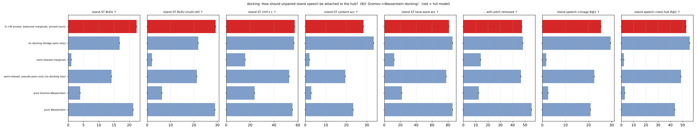

### tone: Does lexical tone need its own gated path into the hub?  (N5: lexical-tonality gate)

_1 seed(s); test split; mean; bold = best in column (arrows give the direction)._

| variant | island ST BLEU ↑ | island ST BLEU (multi-ref) ↑ | island ST chrF++ ↑ | island ST content acc ↑ | island ST tone-word acc ↑ |   ... with pitch removed ↑ | island speech->image R@1 ↑ | island speech->text hub R@1 ↑ | hub ASR WER ↓ | captioning BLEU (multi-ref) ↑ | MT hub->written BLEU ↑ | MT written->hub BLEU ↑ | TTS into island (round-trip BLEU) ↑ | TTS into island (round-trip content) ↑ | text codec CER (written lang) ↓ | gate (island) ↑ | gate (hub lang) ↓ | tone reliance (island) ↑ |
|---|---|---|---|---|---|---|---|---|---|---|---|---|---|---|---|---|---|---|
| gated tone stream (ours) | **22.41** | **29.29** | **57.27** | **28.33** | **81.25** | 47.50 | **25.42** | **52.92** | **35.58** | **25.79** | 43.06 | **51.02** | **10.43** | **15.00** | 11.62 | **0.58** | 0.00 | **0.29** |
| no tone stream (single stream) | 15.49 | 21.32 | 48.08 | 23.33 | 56.25 | **56.25** | 13.33 | 38.33 | 36.77 | 19.05 | **43.30** | 46.15 | 4.27 | 11.67 | **11.59** | 0.00 | **0.00** | 0.00 |

Full model best on: island ST BLEU, island ST BLEU (multi-ref), island ST chrF++, island ST content acc, island ST tone-word acc, island speech->image R@1, island speech->text hub R@1, hub ASR WER, captioning BLEU (multi-ref), MT written->hub BLEU, TTS into island (round-trip BLEU), TTS into island (round-trip content), gate (island), tone reliance (island).
Full model not best on:   ... with pitch removed (best: no tone stream (single stream)), MT hub->written BLEU (best: no tone stream (single stream)), text codec CER (written lang) (best: no tone stream (single stream)), gate (hub lang) (best: no tone stream (single stream)).

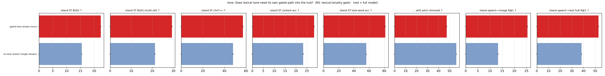

### transitive: What makes two spokes agree on the hub at test time?  (N4: transitive hub-swap)

_1 seed(s); test split; mean; bold = best in column (arrows give the direction)._

| variant | island ST BLEU ↑ | island ST BLEU (multi-ref) ↑ | island ST chrF++ ↑ | island ST content acc ↑ | island ST tone-word acc ↑ |   ... with pitch removed ↑ | island speech->image R@1 ↑ | island speech->text hub R@1 ↑ | hub ASR WER ↓ | captioning BLEU (multi-ref) ↑ | MT hub->written BLEU ↑ | MT written->hub BLEU ↑ | TTS into island (round-trip BLEU) ↑ | TTS into island (round-trip content) ↑ | text codec CER (written lang) ↓ | gate (island) ↑ | gate (hub lang) ↓ | tone reliance (island) ↑ |
|---|---|---|---|---|---|---|---|---|---|---|---|---|---|---|---|---|---|---|
| hub-swap CFM (ours) | **22.41** | **29.29** | 57.27 | 28.33 | 81.25 | 47.50 | **25.42** | **52.92** | **35.58** | 25.79 | 43.06 | **51.02** | **10.43** | **15.00** | 11.62 | 0.58 | 0.00 | 0.29 |
| no cross-spoke term | 21.08 | 27.61 | **58.13** | **30.42** | **88.33** | **51.25** | 25.00 | 50.00 | 53.44 | **30.02** | **48.68** | 48.58 | 5.19 | 10.42 | 11.62 | 0.58 | 0.00 | **0.31** |

Full model best on: island ST BLEU, island ST BLEU (multi-ref), island speech->image R@1, island speech->text hub R@1, hub ASR WER, MT written->hub BLEU, TTS into island (round-trip BLEU), TTS into island (round-trip content).
Full model not best on: island ST chrF++ (best: no cross-spoke term), island ST content acc (best: no cross-spoke term), island ST tone-word acc (best: no cross-spoke term),   ... with pitch removed (best: no cross-spoke term), captioning BLEU (multi-ref) (best: no cross-spoke term), MT hub->written BLEU (best: no cross-spoke term), tone reliance (island) (best: no cross-spoke term).

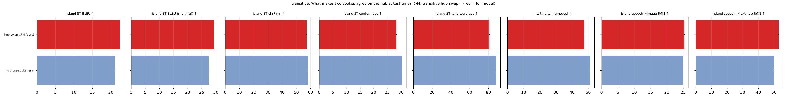

### private: Do the spokes need private (non-hub) degrees of freedom?  (N2: hub (+) private flows)

_1 seed(s); test split; mean; bold = best in column (arrows give the direction)._

| variant | island ST BLEU ↑ | island ST BLEU (multi-ref) ↑ | island ST chrF++ ↑ | island ST content acc ↑ | island ST tone-word acc ↑ |   ... with pitch removed ↑ | island speech->image R@1 ↑ | island speech->text hub R@1 ↑ | hub ASR WER ↓ | captioning BLEU (multi-ref) ↑ | MT hub->written BLEU ↑ | MT written->hub BLEU ↑ | TTS into island (round-trip BLEU) ↑ | TTS into island (round-trip content) ↑ | text codec CER (written lang) ↓ | gate (island) ↑ | gate (hub lang) ↓ | tone reliance (island) ↑ |
|---|---|---|---|---|---|---|---|---|---|---|---|---|---|---|---|---|---|---|
| hub + private Gaussian tokens (ours) | **22.41** | **29.29** | **57.27** | **28.33** | **81.25** | 47.50 | **25.42** | **52.92** | **35.58** | **25.79** | **43.06** | **51.02** | **10.43** | **15.00** | 11.62 | 0.58 | 0.00 | 0.29 |
| private tokens fixed to zero (deterministic spokes) | 7.01 | 19.69 | 39.57 | 18.33 | 79.17 | **57.50** | 15.83 | 20.42 | 64.95 | 10.54 | 8.54 | 14.77 | 5.20 | 3.33 | 11.62 | 0.58 | 0.00 | **0.40** |

Full model best on: island ST BLEU, island ST BLEU (multi-ref), island ST chrF++, island ST content acc, island ST tone-word acc, island speech->image R@1, island speech->text hub R@1, hub ASR WER, captioning BLEU (multi-ref), MT hub->written BLEU, MT written->hub BLEU, TTS into island (round-trip BLEU), TTS into island (round-trip content).
Full model not best on:   ... with pitch removed (best: private tokens fixed to zero (deterministic spokes)), tone reliance (island) (best: private tokens fixed to zero (deterministic spokes)).


## 3. Flickr8k-Tri subset (real data)

English text and speech, Yorùbá speech (orthography held out), Hindi text. This is a pipeline check on a small subset with a small model, not a result to cite.

- Run directory: `runs/f1200`; 1400 representation steps + 1400 flow steps, batch 24, seed 0.
- Retrieval gallery: the 92 test images (chance R@1 1.1 %, R@10 10.9 %).
- Data: 1017 / 91 / 92 images (train / valid / test), 381 bridge pairs and 382 unpaired island utterances in training (bridge budget 50 %).
- Model: 16.68 M parameters; one language costs 104.9 k flow parameters (1.41 % of the shared flow backbone).

| Direction | Metric | Value |
|---|---|---|
| island speech (yo) → en text, zero-pair | BLEU (parallel reference) | 2.51 |
|  | BLEU (all captions of the image) | 4.21 |
|  | chrF++ | 15.66 |
|  | BLEU with the pitch contour removed | 2.52 |
| island speech (yo) → image | R@1 (%) | 3.85 |
|  | R@5 (%) | 16.67 |
|  | R@10 (%) | 30.77 |
| island speech (yo) → en text (hub retrieval) | R@1 (%) | 0.00 |
| en speech → en text | WER (%) | 106.81 |
|  | BLEU | 1.33 |
| en text → image | R@1 (%) | 4.13 |
|  | R@10 (%) | 29.13 |
| en speech → image | R@1 (%) | 5.22 |
|  | R@10 (%) | 40.00 |
| image → en text | BLEU (all captions of the image) | 4.01 |
| en text → hi text, zero-pair | BLEU | 0.15 |
| hi text → en text, zero-pair | BLEU | 1.16 |
| island speech (yo) → hi text, zero-pair | BLEU | 0.15 |
| en text → en speech (round trip) | BLEU | 0.57 |
| en text → island speech (yo) (round trip) | BLEU | 0.62 |
| island speech (yo) → en speech (round trip) | BLEU | 1.61 |
| text codec, en | CER (%) | 67.04 |
| text codec, hi | CER (%) | 80.20 |
| tonality gate, en | γ | 0.35 |
| tonality gate, yo | γ | 0.46 |
| tone-reliance index, en |  | 0.04 |
| tone-reliance index, yo |  | 0.02 |

Inside the model (`inference/report.json`):

- Transport plan at alpha=0.0: argmax is the true partner for 4.2 % of island utterances; 1.0 % of the mass is on true pairs.
- Transport plan at alpha=0.5: argmax is the true partner for 2.1 % of island utterances; 2.2 % of the mass is on true pairs.
- Transport plan at alpha=1.0: argmax is the true partner for 2.1 % of island utterances; 2.1 % of the mass is on true pairs.
- Relational premise: Pearson r = 0.495 between island and hub pairwise distances.
- Hub agreement txt:en|aud:en: AUC(same caption > different caption) = 0.581.
- Hub agreement aud:yo|txt:en: AUC(same caption > different caption) = 0.659.
- Hub agreement aud:yo|aud:en: AUC(same caption > different caption) = 0.687.
- Path straightness (chord / arc length): hub -> text (write) 0.987; speech:yo -> hub (read) 0.975.
- Plain ODE cycle loss against solver steps (midpoint): 1 steps 4.29e+00, 2 steps 1.08e+00, 4 steps 1.74e-01, 8 steps 2.80e-02, 16 steps 1.66e-03, 32 steps 3.11e-05.
- Island translation score against ODE steps per hop: 1: 1.2, 2: 3.1, 4: 2.7, 8: 2.2, 16: 2.6.
- Pitch-contour scaling, en: hub displacement ×0 → 0.032, ×0.25 → 0.018, ×0.5 → 0.007, ×1 → 0.000, ×1.5 → 0.005, ×2 → 0.014.
- Pitch-contour scaling, yo: hub displacement ×0 → 0.024, ×0.25 → 0.015, ×0.5 → 0.007, ×1 → 0.000, ×1.5 → 0.006, ×2 → 0.017.
- Share of the gradient attribution that falls on the pitch contour: en 0.2 %, yo 0.3 %.
- Units per word, grapheme (ours): en 4.65, yo 4.97, hi 3.23.
- Units per word, byte: en 4.65, yo 6.41, hi 11.16.
- Units per word, BPE-2000 (hub language only): en 1.15, yo 4.99, hi 11.15.
- Relative size of the language LoRA in the txt spoke (‖BA‖/‖W‖, mean over layers): en 0.089, yo 0.000, hi 0.083.
- Relative size of the language LoRA in the aud spoke (‖BA‖/‖W‖, mean over layers): en 0.088, yo 0.091, hi 0.000.
- Speech codec, frame cosine between natural and reconstructed segmental stream (one utterance): en 0.235, yo 0.387.

Sample outputs, island speech (yo) → en text:

| reference | output |
|---|---|
| A closeup of a white dog that is laying its head on its paws . | A boy with a black and a black and a black the . |
| A baby in a white garment holds a flag with crescent moon and star . | A man in a black and a standing a black and a ball . |
| A boy is jumping on a bed . | A boy in a black and a black . |
| a biker enjoys a coffee . | A man is boy a black a ball . |
| A group of people in costume at a renaissance fair . | A man is boy in a black a rack . |
| Three women standing on a city street . | A young girl in a black in a black . |
| A large man sits in the back of a canoe with another man in front on a river . | A man in a black and a black and a black and a black and a black and and balll back back . |
| A dog waits as his owner rummages through a collection of stuff . | A dog is running a ron the stand with a red strand in the . |

## 4. Files behind these numbers

`runs/` is not versioned; the artefacts behind this document are copied to `docs/results/`.

### SynthWorld reference run (`docs/results/synth/`)

Metrics `eval_test.json`, internals `report.json`, sample conversions `translations.md`, synthesised speech `speech/*.wav`, training curves and all figures in `figures/`.

**Where each hub slot looks, for text, speech and island speech of the same caption**

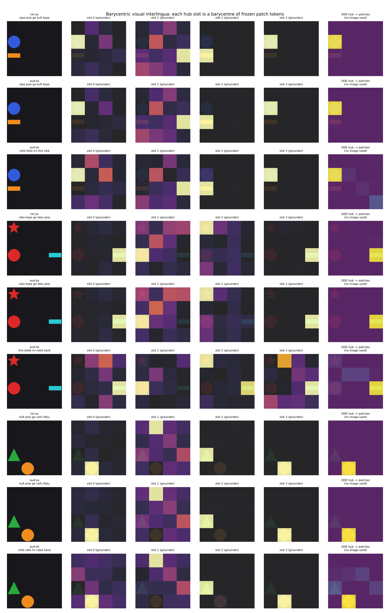

**Tonality gates, hub displacement and tone-word accuracy against pitch-contour scaling**

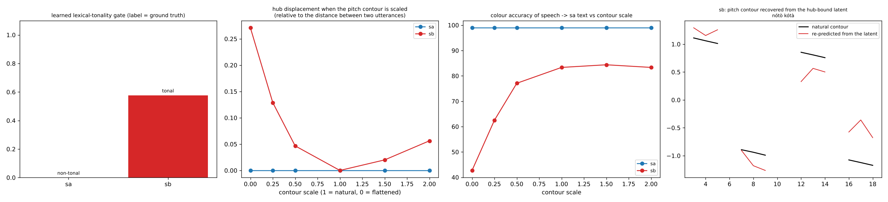

**Transport plans between island speech and hub codes, with the true partners marked**

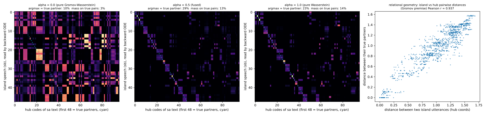

**Quality against ODE steps; the plain ODE cycle vanishes with the step size**

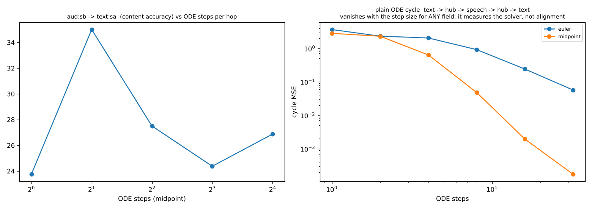

**All views in hub coordinates**


**Linear probes on the hub and private halves of a speech read-out**

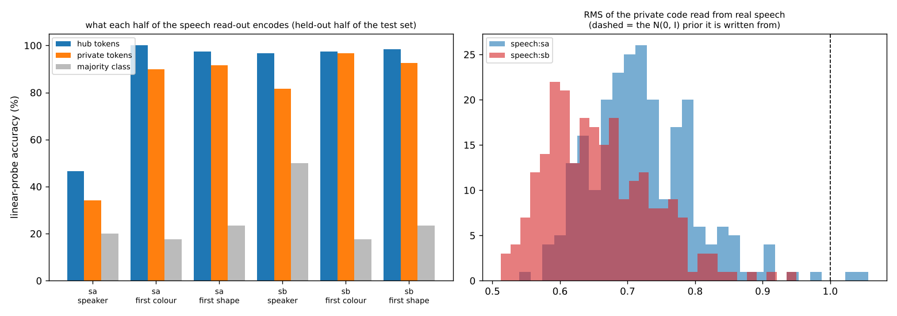

**Units per word and per written symbol for each script**


### Flickr8k-Tri subset (`docs/results/real/`)

Metrics `eval_test.json`, internals `report.json`, sample conversions `translations.md`, synthesised speech `speech/*.wav`, training curves and all figures in `figures/`.

**Where each hub slot looks, for text, speech and island speech of the same caption**

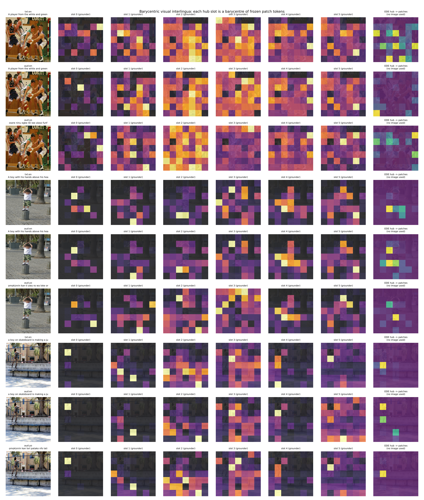

**Tonality gates, hub displacement and tone-word accuracy against pitch-contour scaling**

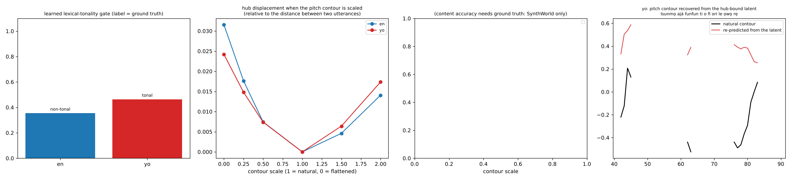

**Transport plans between island speech and hub codes, with the true partners marked**

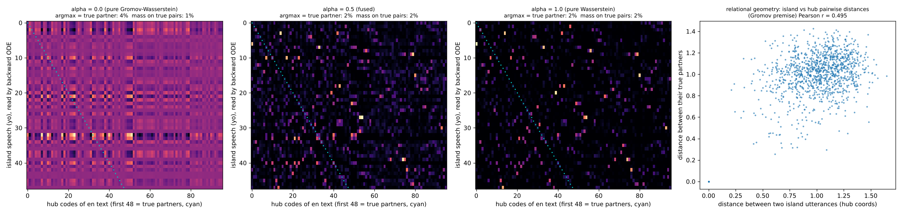

**Quality against ODE steps; the plain ODE cycle vanishes with the step size**

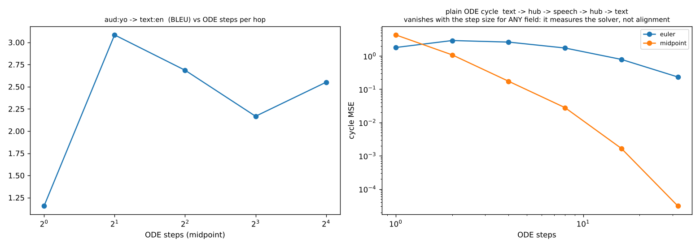

**All views in hub coordinates**

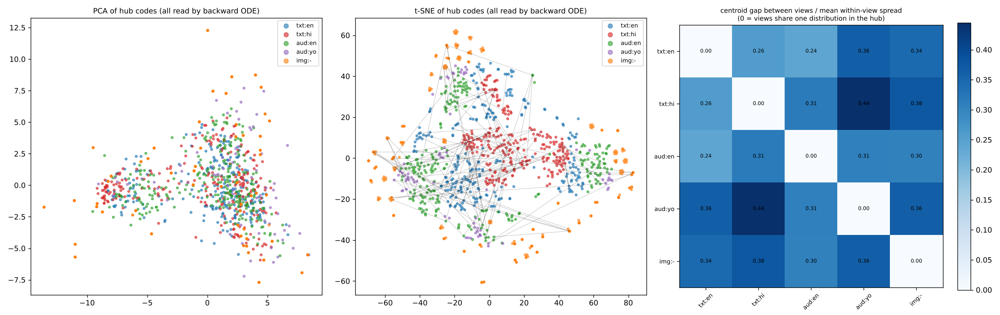

**Linear probes on the hub and private halves of a speech read-out**

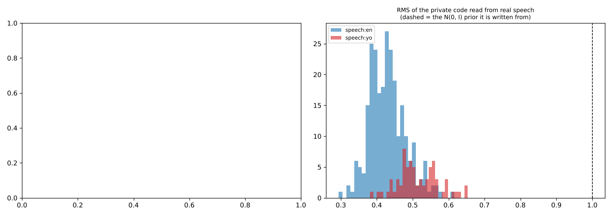

**Units per word and per written symbol for each script**

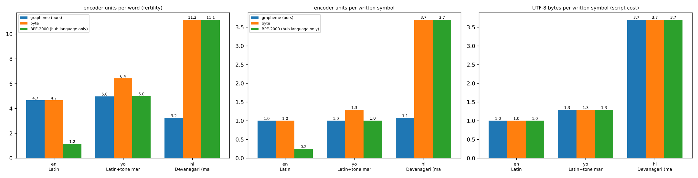

### Ablation (`docs/results/ablation/`)

Tables as Markdown, CSV and LaTeX, bar charts, and the full test metrics of every cell in `cells/`.

