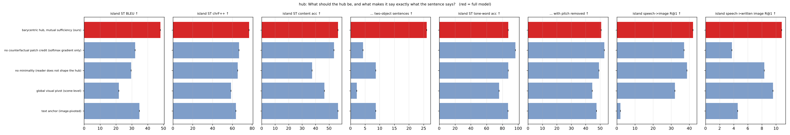
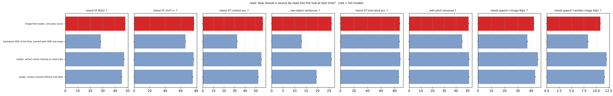
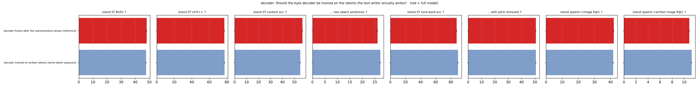
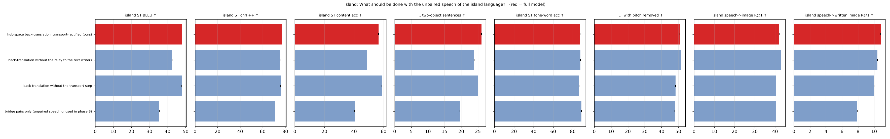
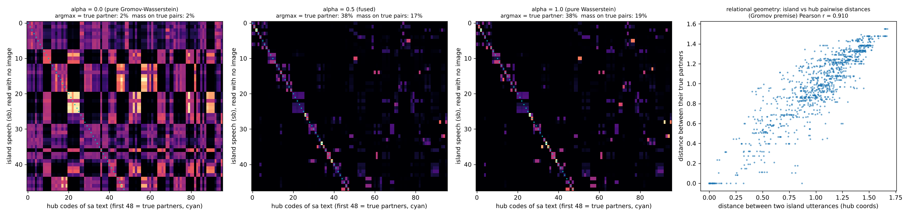
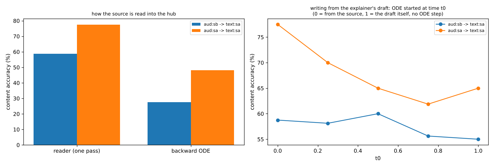
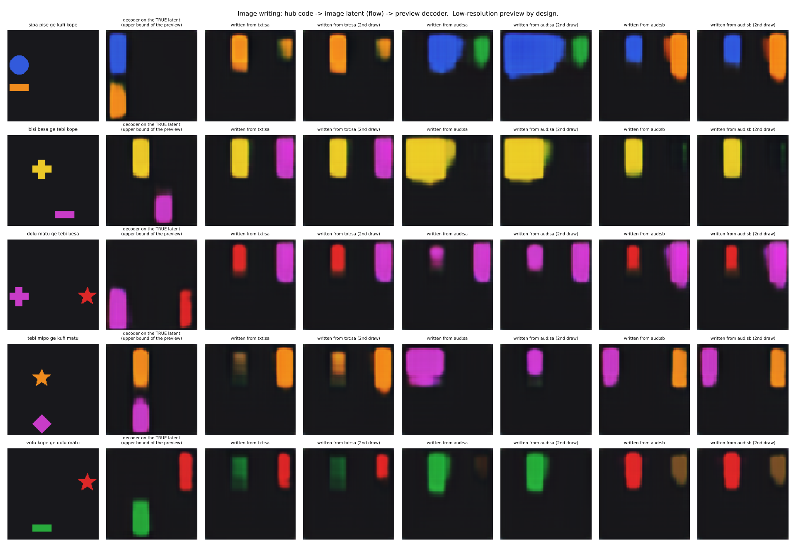
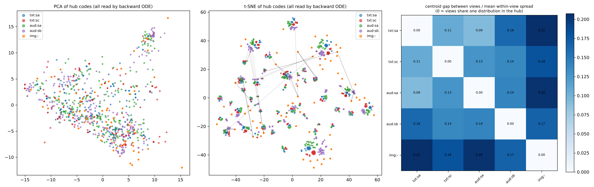
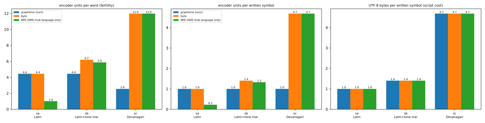

# Results measured so far

Everything below was produced by the code in this repository on a machine with **4 CPU cores and no GPU**.
The runs are therefore small: 3,000 optimisation steps (1,500 representation + 1,500 transport), a model of 5.9 M
parameters, **one seed**, and a test set of 240 caption groups (60 images). With 240 utterances a difference of
fewer than about 8 points between two rows is within noise; the two-object columns rest on 92 captions and are
noisier still. The numbers show that the pipeline runs end to end and which mechanisms have an effect in a
controlled setting. They are **not** the numbers of a paper: those need the GPU schedule in
`scripts/paper_experiments.sh` or the notebook (full data, three seeds, significance tests).

Sections 1–4 are generated from the JSON files under `runs/` by

```bash
python scripts/make_results.py --synth runs/sf_ablation/_full/full_s0 --ablation runs/sf_ablation --real_check runs/real_smoke
```

## 0. What the runs show

**Reference run (SynthWorld, full model, test split; section 1).** `sa` is the hub language, `sb` a tonal language
with speech only, `sc` a Devanagari-script language with text only. Training sees 205 image–speech bridge pairs
of `sb`, 875 unpaired `sb` utterances, no `sb` text and no sentence in two languages.

- *Zero-pair speech translation of an unwritten, tonal language.* `sb` speech → `sa` text: BLEU 48.1, chrF++ 77.1,
  exact content 56.7 % (75.7 % on one-object sentences, 26.1 % on two-object sentences). The previous design of
  this repository reached BLEU 22.4 and 28 % on the same split.
- *Tone survives, and only where it is lexical.* Tone-contrastive (colour) words are right in 87.5 % of island
  utterances and in 50.8 % when the pitch contour is removed from the input; the learned gate is 0.87 for the
  tonal language and 0.01 for the non-tonal one, whose colour accuracy (98.3 %) is identical with and without
  pitch.
- *Hub-language speech recognition through the hub.* WER 13.5 %, exact content 75.4 % (100 % on one-object
  sentences, 35.9 % on two-object sentences).
- *Zero-pair text translation across scripts.* `sa` → `sc` 76.7 % exact content (BLEU 66.8), `sc` → `sa` 85.0 %
  (BLEU 79.9); island speech → `sc` text 51.3 %.
- *What the hub code keeps of a sentence.* Reading a sentence and writing it again in the same language is exact
  for 87.5 % (67.4 % of two-object sentences). With the image in hand, the grounder covers both objects of a
  two-object caption in 92 % of text captions, 63 % of hub-language speech and 60 % of island speech; 7–12 % of
  the slots sit on an object the sentence does not mention.
- *Retrieval in hub coordinates* (60 images; chance R@1 1.7 %): text → image R@1 55.4 %, island speech → image
  42.1 %, hub-language speech → image 50.0 %.

**What was learned on the way to this configuration** (validation split, single runs; the first two are also
cells of the `hub` ablation).

- *Counterfactual patch credit is what recovers the second object.* Without it both objects of a two-object text
  caption were covered in 68 % of cases in one run (speech 25 %, island speech 30 %) and 36 % in the ablation
  cell; with it 92–94 % in three runs (speech 59–67 %, island speech 58–68 %). Without the credit the outcome
  depends on the run; with it it does not.
- *Stricter versions of it are worse.* A veto on moves that verifiably explain less gave 75 % / 30 % / 51 %.
  Requiring a verified gain before pulling switched the mechanism off (6 %): the explainer has to co-adapt before
  a newly covered object pays off. The latter variant is not kept in the code.
- *"Text teaches speech" in the grounder is harmful.* Making the text code a fixed target for speech dropped the
  coverage of two-object text captions to 22 % and 12 % (two seeds) from 68 % with mutual agreement.
- *The reader beats the backward ODE as a read path for speech* (hub-language speech → text 77 % vs 52 % exact
  content, island 61.5 % vs 41 % on 200 validation captions), and starting the writer from the explainer's draft
  lowers two-object accuracy, so it is off by default.

**What the ablations say** (section 2; test split, one seed, 1,500 + 1,500 steps per cell; "ours" is the
reference run above).

- *Counterfactual patch credit.* Without it, two-object sentences collapse: read-and-rewrite of text 23.9 % (ours
  67.4 %), island speech 4.3 % (26.1 %), both objects covered for 36 % of text captions (92 %) and 9 % of island
  captions (60 %); hub-language recognition WER 31.3 % (13.5 %), text translation 66.7 % / 71.2 % (76.7 % /
  85.0 %). Its price: 7.3 % of slots sit on an unmentioned object (0.2 % without). On one-object sentences it
  changes nothing, so overall island content moves only from 53.8 % to 56.7 %.
- *Minimality.* Without it every object in the picture gets a slot (both covered 100 %, but 20 % of slots on
  unmentioned objects) and the code stops being what the sentence says: island content 37.5 % (56.7 %),
  read-and-rewrite of two-object text 42.4 % (67.4 %).
- *Sentence-level visual hub vs scene-level visual pivot.* The pivot loses on every translation column: island
  BLEU 21.9 (48.1), hub-language WER 45.4 % (13.5 %), text translation 50.8 % / 58.3 % (76.7 % / 85.0 %).
- *Visual hub vs text anchor.* The text anchor ties on island → hub-language text (56.7 % content, BLEU 34.8 vs
  48.1) and on recognition, is **better** at read-and-rewrite of two-object text (83.7 % vs 67.4 %), and is worse
  for the third language (60.0 % / 58.3 % vs 76.7 % / 85.0 %) and useless for images (retrieval at chance). The
  claim that survives is "balanced across languages and modalities", not "better everywhere".
- *Hub-space back-translation.* Bridge pairs alone give 40.4 % island content (BLEU 35.5); adding
  back-translation of the 875 unpaired utterances gives 56.7 % (48.1). Without the relay to the text writers it
  is 48.8 % (42.5): the relay is about half of the gain, at the edge of the noise.
- *Transport rectification of the pseudo codes: no measurable effect* (58.8 % without it vs 56.7 %). It stays in
  the code as an option and should not be claimed.
- *Read-hub exposure and hub jitter: no measurable effect* (55.4 % with neither, 52.5 % without jitter, vs
  56.7 %).
- *Reader vs backward ODE.* For speech the one-pass reader is far better: island content 56.7 % vs 32.5 %,
  hub-language WER 13.5 % vs 26.1 %. For text the backward ODE is better: read-and-rewrite of two-object text
  91.3 % vs 67.4 %, text translation 81.2 % / 88.3 % vs 76.7 % / 85.0 %. A per-modality read mode would take the
  better of each; it was not trained.
- *Tone stream.* Without it, tone-contrastive words on the island fall from 87.5 % to 73.3 %, island content from
  56.7 % to 43.3 %, island speech → image R@1 from 42.1 % to 32.5 %; the non-tonal hub language moves within
  noise (75.4 % → 71.7 %).
- *Not run under this design:* the bridge-budget sweep, private tokens, LoRA rank, text units, the protocol
  group, the veto and "text teaches speech" cells of `hub`, Gromov–Wasserstein docking, the free anchor, and the
  canonical-code cell of `read`. The numbers quoted for the veto and for "text teaches speech" above are
  validation-split diagnostics of single runs.

**Does not work yet.**

- *The second thing a sentence says, from speech.* Two-object sentences are translated correctly from island
  speech in 26 % of cases and transcribed from hub-language speech in 36 %, against 67 % for text. The grounder
  covers both objects for 60–63 % of spoken captions; the rest of the gap is in the speech reader.
- *Image captioning and image writing.* Image → text reaches 9.6 % exact content: an image does not say which of
  its objects a caption is about, and a single read of the image latent does not either. Written image latents
  retrieve the right image at R@1 13.3 % (text) and 10.8 % (island speech); R@10 35 % and 32 % (chance 16.7 %).
  The preview (`15_generated_images.png`) shows blobs of mostly the right colours in the wrong places: a caption
  does not say where things are. The preview decoder of the reference run was refitted alone after training
  (`scripts/refit_preview.py`): with the plain L1 loss it had been trained with, it drew only background. It
  shares no gradient with the rest of the model, so no number in this document depends on it; the ablation cells
  were trained before that fix.
- *The speaker is not kept out of the hub.* A linear probe finds the speaker in the reader's hub code with
  31.7 % accuracy for the hub language (chance 20 %; 41.7 % in the backward-ODE read-out) and 80.8 % for the
  island (chance 50 %; 84.2 %). The reader leaks less than the ODE, not nothing.
- *Speech into the island language.* Text → island speech → (re-read) text recovers the content in 36.7 % of
  cases (50.4 % for hub-language speech); this is a feature-level round trip, not a listening test.

**Real data: the first full run failed** (Flickr8k-Tri, Kaggle 2 × T4, preset `flickr8k_yo_t4` as it was then:
16,000 + 30,000 steps, 74 M parameters, one seed; numbers read off the log of that run, which trained to the end;
nothing from it is stored in this repository).

| Test split, best checkpoint (step 30,000) | |
|---|---|
| English text → hub → English text, BLEU | 2.05 |
| English speech → English text, BLEU | 1.22 |
| Yorùbá speech → English text, BLEU | 0.91 |
| Hindi text → English text / English text → Hindi text, BLEU | 1.43 / 0.92 |
| Yorùbá speech → Hindi text, BLEU | 0.49 |
| Image → English text, BLEU | 0.42 |
| Retrieval of the image among 624, R@1 (chance 0.16 %): English text / Hindi text / English speech / Yorùbá speech | 11.76 / 6.09 / 4.01 / 1.16 % |
| Same, with the image latent written by the flow | 12.02 / 5.90 / 3.69 / 1.54 % |

The first row is the diagnosis: the source is text and the target is the same language, so nothing has to be
recognised or translated, and the output is still unreadable. The failure is in writing text from a hub code.

- *The machinery works.* Download, split, feature extraction (45,981 utterances, 50.4 h of speech, 42 minutes in
  all), both GPUs (`cuda x2 (DataParallel)`, one batch of 64 per GPU and step, mixed precision), checkpoints,
  validation: no error. Speed: 1.15 steps/s in the representation phase, 3.1 in the transport phase, 1.7 once
  back-translation starts.
- *Text written through the hub is unreadable.* English speech → English text: BLEU 1.3–1.6, WER 92–95 %;
  Yorùbá speech → English text: BLEU 0.9–1.5; image → text: BLEU 0.3–0.6. Retrieval says the hub itself carries
  content (English text → image R@1 17–19 % among 620 images, chance 0.16 %), so the failure is in turning a hub
  code back into text. On real captions the hub explains about 28 % of the text latent's variance on held-out
  data (86 % on SynthWorld); the writer has to invent the rest, and the byte decoder had only ever been trained
  on exact encoder latents.
- *The representation phase overfits.* Training grounding accuracy reached 99 %, validation peaked at 63 % after
  4,000 steps and fell to 53 %; validation unexplained variance rose from 0.55 to 0.72; the reader's validation
  error rose throughout the transport phase (0.176 → 0.187 text, 0.244 → 0.256 speech) while the training error
  fell.
- *The credit weight is high.* Its mean rose from 0.25 to 0.78 after the release and the training loss rose with
  it (4.0 → 5.4): with 49 diverse patches and half of the latent unexplained, the best of many first-order
  estimates is usually large. On SynthWorld the mean is 0.4–0.5 where the credit works; whether it helps or
  disturbs on real photographs cannot be read off this log.
- *The tonality gate did the opposite of the claim.* English 0.55, Yorùbá 0.00. Every language in a batch paid the
  same price for its gate, while only image-paired utterances can show that pitch is useful; Yorùbá has 985 of
  them, English 30,000.
- *Yorùbá speech → image retrieval is close to chance* (1 of 67 validation utterances at R@1; 1.16 % on test).
- *The transport phase overfits as well.* Validation split, measured every 2,000 steps: the flow-matching error
  of the image writer was lowest after 4,000 transport steps (0.380) and rose to 0.632 by the end; that of the
  speech writer was lowest after 10,000 (0.411) and ended at 0.456; that of the text writer was lowest after
  14,000 (0.374) and ended at 0.387; the reader's error rose throughout (text 0.176 → 0.205, speech 0.244 →
  0.264); English text → image R@1 fell from 18.8 % to about 15 %. The writers are trained on a fixed set of
  cached latents. The validation score that selects the checkpoint peaked after 14,000 transport steps, with text
  scores too low to mean anything.
- *The session ended inside the ablation.* Preparation took 42 min, training ended 9 h 07 min after the start of
  the cell, the test evaluation took 11 min and the sixteen figures 2 min. The ablation then trained the
  representation phase again from scratch, although the main run held exactly that representation, and Kaggle's
  12-hour limit cut it at step 10,533 of 16,000: 2 h 40 min that produced nothing.
- *Two runs of the same representation phase separate.* That repeated phase had the same settings, seed and data
  order as the first, and its logged losses agree with the first to three decimals for 2,000 steps. After that
  the speech codec's semantic reconstruction error falls more slowly on the training data (0.57 against 0.47 at
  step 10,000) and, on held-out speech, does not fall at all: 0.85 at step 10,000 against 0.67. Text
  reconstruction, the mel and pixel losses and grounding accuracy stay within a few hundredths of the first run,
  and the reader's held-out error on speech is no worse (0.340 against 0.362 at step 8,000). Whether the speech
  codec learns a code that generalises was decided by GPU non-determinism in this pair of runs. One seed cannot
  carry a claim about speech output on real data.

**What was changed in response, and what was tried and rejected** (SynthWorld, single runs; the two-object
coverage is the validation-split diagnostic used throughout).

- *Kept: write-latent exposure of the byte decoder* (`w_dec`; section 2, group `decoder`). Same phase-A state,
  test split: read-and-rewrite of text 87.5 % → 95.8 % (two-object sentences 67.4 % → 89.1 %), hub-language
  recognition WER 13.5 % → 8.6 %, zero-pair text translation 76.7 % / 85.0 % → 92.1 % / 93.8 %; island speech
  unchanged (55.0 % vs 56.7 %).
- *Kept:* a shorter schedule (8,000 + 14,000 steps); the transport phase starts from the phase-A state with the
  best validation hub losses (`phase_a_select`); noise on the latents the reader is trained on (`read_noise`); a
  gate price paid per grounded utterance (`gate_price = evidence`); sample outputs and a data-versus-compute
  timing line in the log at every validation; resuming a run folder under different settings is refused.
- *Rejected: dropout.* Residual dropout 0.1 in the codecs, grounder, explainer and reader destroys the two-object
  coverage the credit loss buys: 13 % of text captions against 93 %. It is the standard answer to the overfitting
  seen on Flickr8k and it is not in the presets for this reason.
- *Rejected: a scale-free credit rule* (gain relative to the utterance's unexplained variance): coverage 49 %.
  With the veto on top and all regularisers: 4 %. The variant was removed from the code.
- *Not adopted: speech time masking + weight decay 0.05* (with the evidence gate price, no dropout): coverage
  72 %, not separated from run-to-run noise.
- With exactly the option set of the real-data presets switched on, SynthWorld gives: island speech → text 60.8 % exact content (reference 56.7 %), hub-language
  recognition WER 10.1 % (13.5 %), read-and-rewrite of text 96.3 % (87.5 %), zero-pair text translation 89.6 % /
  94.2 % (76.7 % / 85.0 %), both objects covered for 97 % of two-object text captions (92 %), gates 0.00 / 0.92.
  Trained from scratch (1,500 + 1,500 steps), test split; nothing got worse
  (`docs/results/synth_with_real_preset_options_eval_test.json`).

- *Kept, after the complete log:* the ablation never trains what the main run has (the main run is its full
  model, and its phase-A checkpoint is used by every variant that leaves the representation alone); the cell and
  the command line take a time budget and stop on a saved step before a hosted session is cut; the transport
  phase is 14,000 steps, where that run's validation score peaked.
- *Open: the transport phase has no regulariser of its own* beyond the jitter on hub codes, the noise on the
  reader's inputs and the checkpoint selection. Dropout inside the writers would not touch the credit loss, which
  acts in the representation phase; it has not been tried.

**None of this has been run on real data at scale.** The changes answer what the log showed; whether they are
enough is not known until the next GPU run.

**Not verified.**

- *Real data, again.* No real-data number in this repository supports any claim.
- *Seeds.* Everything is one seed.

## 1. SynthWorld reference run

Controlled benchmark; `sa` = hub language, `sb` = tonal, speech-only island, `sc` = Devanagari-script text.  Content accuracy is exact (the output is parsed and compared with the true content of the source utterance).

- Run directory: `runs/sf_ablation/_full/full_s0`; 1500 representation steps + 1500 flow steps, batch 48, seed 0.
- Retrieval gallery: the 60 test images (chance R@1 1.7 %, R@10 16.7 %).
- Data: 1080 / 60 / 60 images (train / valid / test), 205 bridge pairs and 875 unpaired island utterances in training (bridge budget 20 %).
- Model: 5.90 M parameters; one language costs 52.5 k flow parameters (2.09 % of the shared flow backbone).

| Direction | Metric | Value |
|---|---|---|
| island speech (sb) → sa text, zero-pair | BLEU (parallel reference) | 48.06 |
|  | BLEU (all captions of the image) | 52.27 |
|  | chrF++ | 77.05 |
|  | exact content accuracy (%) | 56.67 |
|  | tone-contrastive word accuracy (%) | 87.50 |
|  | … with the pitch contour removed (%) | 50.83 |
|  | share of colour errors that are the tonal twin (%) | 30.00 |
|  | BLEU with the pitch contour removed | 16.70 |
| island speech (sb) → image | R@1 (%) | 42.08 |
|  | R@5 (%) | 84.17 |
|  | R@10 (%) | 96.25 |
| island speech (sb) → written image latent | R@1 (%) | 10.83 |
| sa text → written image latent | R@1 (%) | 13.33 |
| island speech (sb) → sa text (hub retrieval) | R@1 (%) | 81.67 |
| sa speech → sa text | WER (%) | 13.49 |
|  | exact content accuracy (%) | 75.42 |
|  | BLEU | 65.79 |
| sa text → image | R@1 (%) | 55.42 |
|  | R@10 (%) | 99.17 |
| sa speech → image | R@1 (%) | 50.00 |
|  | R@10 (%) | 97.50 |
| image → sa text | BLEU (all captions of the image) | 23.06 |
| sa text → sc text, zero-pair | BLEU | 66.76 |
|  | exact content accuracy (%) | 76.67 |
| sc text → sa text, zero-pair | BLEU | 79.91 |
|  | exact content accuracy (%) | 85.00 |
| island speech (sb) → sc text, zero-pair | BLEU | 37.06 |
| sa text → sa speech (round trip) | BLEU | 25.52 |
|  | exact content accuracy (%) | 50.42 |
| sa text → island speech (sb) (round trip) | BLEU | 14.40 |
|  | exact content accuracy (%) | 36.67 |
| island speech (sb) → sa speech (round trip) | BLEU | 13.10 |
| text codec, sa | CER (%) | 0.99 |
| text codec, sc | CER (%) | 4.57 |
| tonality gate, sa | γ | 0.01 |
| tonality gate, sb | γ | 0.87 |
| tone-reliance index, sa |  | 0.00 |
| tone-reliance index, sb |  | 0.32 |

Inside the model (`inference/report.json`):

- Pointing game, txt:sa: 76.2 % of hub slots sit on a described object (chance 8.4 %); some slot hits one in 100.0 % of captions.
- Pointing game, aud:sa: 76.2 % of hub slots sit on a described object (chance 8.4 %); some slot hits one in 100.0 % of captions.
- Pointing game, aud:sb: 75.0 % of hub slots sit on a described object (chance 8.4 %); some slot hits one in 100.0 % of captions.
- Island speech read with no image vs the hub codes of its (never seen) translations: Pearson r = 0.910 between the two sets of pairwise distances; an optimal-transport plan on position alone (alpha = 1) finds the true partner for 37.5 % of utterances, on relational structure alone (alpha = 0) for 2.1 %.
- Hub agreement txt:sa|aud:sa: AUC(same caption > different caption) = 0.870.
- Hub agreement aud:sb|txt:sa: AUC(same caption > different caption) = 0.841.
- Hub agreement aud:sb|aud:sa: AUC(same caption > different caption) = 0.835.
- Path straightness (chord / arc length): hub -> text (write) 0.989; speech:sb -> hub (backward ODE) 0.985.
- Plain ODE cycle loss against solver steps (midpoint): 1 steps 2.23e+00, 2 steps 6.12e-01, 4 steps 6.68e-02, 8 steps 2.25e-03, 16 steps 1.01e-04, 32 steps 1.65e-05.
- Island translation score against ODE steps per hop: 1: 56.9, 2: 58.1, 4: 58.8, 8: 58.1, 16: 58.8.
- Pitch-contour scaling, sa: hub displacement ×0 → 0.000, ×0.25 → 0.000, ×0.5 → 0.000, ×1 → 0.000, ×1.5 → 0.000, ×2 → 0.000.
- Pitch-contour scaling, sb: hub displacement ×0 → 0.386, ×0.25 → 0.168, ×0.5 → 0.055, ×1 → 0.000, ×1.5 → 0.021, ×2 → 0.056.
- Share of the gradient attribution that falls on the pitch contour: sa 0.0 %, sb 8.4 %.
- Units per word, grapheme (ours): sa 4.44, sb 4.44, sc 2.56.
- Units per word, byte: sa 4.44, sb 6.21, sc 11.98.
- Units per word, BPE-2000 (hub language only): sa 1.00, sb 5.87, sc 11.98.
- Linear probe for sa/speaker: reader hub 31.7 %, backward-ODE hub 41.7 %, backward-ODE private tokens 43.3 % (majority class 20.0 %).
- Linear probe for sa/first colour: reader hub 100.0 %, backward-ODE hub 96.7 %, backward-ODE private tokens 92.5 % (majority class 17.5 %).
- Linear probe for sa/first shape: reader hub 96.7 %, backward-ODE hub 97.5 %, backward-ODE private tokens 89.2 % (majority class 23.3 %).
- Linear probe for sb/speaker: reader hub 80.8 %, backward-ODE hub 84.2 %, backward-ODE private tokens 82.5 % (majority class 50.0 %).
- Linear probe for sb/first colour: reader hub 95.0 %, backward-ODE hub 99.2 %, backward-ODE private tokens 85.8 % (majority class 17.5 %).
- Linear probe for sb/first shape: reader hub 95.8 %, backward-ODE hub 95.0 %, backward-ODE private tokens 81.7 % (majority class 23.3 %).
- aud:sb → hub-language text: reader (one pass) 58.8, backward ODE 27.5; starting the writer from the explainer's draft at t0 = 0.0: 58.8, 0.25: 58.1, 0.5: 60.0, 0.75: 55.6, 1.0: 55.0.
- aud:sa → hub-language text: reader (one pass) 77.5, backward ODE 48.1; starting the writer from the explainer's draft at t0 = 0.0: 77.5, 0.25: 70.0, 0.5: 65.0, 0.75: 61.9, 1.0: 65.0.
- Relative size of the language LoRA in the txt spoke (‖BA‖/‖W‖, mean over layers): sa 0.142, sb 0.000, sc 0.130.
- Relative size of the language LoRA in the aud spoke (‖BA‖/‖W‖, mean over layers): sa 0.142, sb 0.148, sc 0.000.
- Speech codec, frame cosine between natural and reconstructed segmental stream (one utterance): sa 0.706, sb 0.847.

Sample outputs, island speech (sb) → sa text:

| reference | output |
|---|---|
| sipa pise | sipa pise |
| sipa pise ge kufi kope | sipa pise ge kufi kope |
| kufi kope | kufi kope |
| sipa pise | sipa pise |
| viba febu ge sipa pise | sipa febu ge tasa kope |
| sipa pise ge viba febu | sipa pise ge tebi nubu |
| sipa pise | sipa pise |
| sipa pise ge viba febu | sipa pise ge tebi nubu |

## 2. Ablations on SynthWorld


Dataset `synthworld`, seeds [0].  Every number is measured on the test split, through the hub, with no image and no text of the island language at test time.

### hub: What should the hub be, and what makes it say exactly what the sentence says?

_1 seed(s); test split; mean; bold = best in column (arrows give the direction)._

| variant | island ST BLEU ↑ | island ST chrF++ ↑ | island ST content acc ↑ |   ... two-object sentences ↑ | island ST tone-word acc ↑ |   ... with pitch removed ↑ | island speech->image R@1 ↑ | island speech->written image R@1 ↑ | hub ASR content acc ↑ | hub ASR WER ↓ | captioning BLEU (multi-ref) ↑ | MT hub->written content acc ↑ | MT hub->written BLEU ↑ | MT written->hub BLEU ↑ | text->written image R@1 ↑ | TTS into island (round-trip BLEU) ↑ | TTS into island (round-trip content) ↑ | text read+write, two-object sentences ↑ | both objects covered (text) ↑ | both objects covered (island speech) ↑ | slots on unmentioned objects (text) ↓ | gate (island) ↑ | gate (hub lang) ↓ |
|---|---|---|---|---|---|---|---|---|---|---|---|---|---|---|---|---|---|---|---|---|---|---|---|
| barycentric hub, mutual sufficiency (ours) | **48.06** | **77.05** | **56.67** | **26.09** | 87.50 | 50.83 | **42.08** | **10.83** | 75.42 | 13.49 | 23.06 | **76.67** | **66.76** | **79.91** | **13.33** | 14.40 | 36.67 | 67.39 | 92.39 | 59.78 | 7.29 | 0.87 | 0.01 |
| no counterfactual patch credit (softmax gradient only) | 32.20 | 66.77 | 53.75 | 4.35 | **96.67** | **52.92** | 37.08 | 3.75 | 63.33 | 31.35 | 17.26 | 66.67 | 49.57 | 63.23 | 10.83 | **18.58** | **39.17** | 23.91 | 35.87 | 8.70 | **0.21** | 0.66 | **0.00** |
| no minimality (reader does not shape the hub) | 29.61 | 65.47 | 37.50 | 8.70 | 87.50 | 49.17 | 38.75 | 8.33 | 74.58 | 16.67 | **36.69** | 74.17 | 61.28 | 76.87 | 12.08 | 12.02 | 31.25 | 42.39 | **100.00** | **67.39** | 20.42 | **0.90** | 0.05 |
| global visual pivot (scene-level) | 21.92 | 58.72 | 46.67 | 2.17 | 75.83 | 44.58 | 32.08 | 9.58 | 43.75 | 45.37 | 7.43 | 50.83 | 35.17 | 41.34 | 10.00 | 7.85 | 15.83 | 22.83 | nan | nan | nan | 0.87 | 0.01 |
| text anchor (image-pivoted) | 34.77 | 63.64 | 56.67 | 8.70 | 87.08 | 47.50 | 2.08 | 4.58 | **75.83** | **11.90** | 36.27 | 60.00 | 37.07 | 33.23 | 5.42 | 18.32 | 30.83 | **83.70** | nan | nan | nan | 0.87 | 0.01 |

Full model best on: island ST BLEU, island ST chrF++, island ST content acc,   ... two-object sentences, island speech->image R@1, island speech->written image R@1, MT hub->written content acc, MT hub->written BLEU, MT written->hub BLEU, text->written image R@1.
Full model not best on: island ST tone-word acc (best: no counterfactual patch credit (softmax gradient only)),   ... with pitch removed (best: no counterfactual patch credit (softmax gradient only)), hub ASR content acc (best: text anchor (image-pivoted)), hub ASR WER (best: text anchor (image-pivoted)), captioning BLEU (multi-ref) (best: no minimality (reader does not shape the hub)), TTS into island (round-trip BLEU) (best: no counterfactual patch credit (softmax gradient only)), TTS into island (round-trip content) (best: no counterfactual patch credit (softmax gradient only)), text read+write, two-object sentences (best: text anchor (image-pivoted)), both objects covered (text) (best: no minimality (reader does not shape the hub)), both objects covered (island speech) (best: no minimality (reader does not shape the hub)), slots on unmentioned objects (text) (best: no counterfactual patch credit (softmax gradient only)), gate (island) (best: no minimality (reader does not shape the hub)), gate (hub lang) (best: no counterfactual patch credit (softmax gradient only)).



### read: How should a source be read into the hub at test time?

_1 seed(s); test split; mean; bold = best in column (arrows give the direction)._

| variant | island ST BLEU ↑ | island ST chrF++ ↑ | island ST content acc ↑ |   ... two-object sentences ↑ | island ST tone-word acc ↑ |   ... with pitch removed ↑ | island speech->image R@1 ↑ | island speech->written image R@1 ↑ | hub ASR content acc ↑ | hub ASR WER ↓ | captioning BLEU (multi-ref) ↑ | MT hub->written content acc ↑ | MT hub->written BLEU ↑ | MT written->hub BLEU ↑ | text->written image R@1 ↑ | TTS into island (round-trip BLEU) ↑ | TTS into island (round-trip content) ↑ | text read+write, two-object sentences ↑ | both objects covered (text) ↑ | both objects covered (island speech) ↑ | slots on unmentioned objects (text) ↓ | gate (island) ↑ | gate (hub lang) ↓ |
|---|---|---|---|---|---|---|---|---|---|---|---|---|---|---|---|---|---|---|---|---|---|---|---|
| image-free reader, one pass (ours) | **48.06** | **77.05** | **56.67** | **26.09** | 87.50 | 50.83 | 42.08 | 10.83 | 75.42 | 13.49 | 23.06 | 76.67 | 66.76 | 79.91 | 13.33 | 14.40 | 36.67 | 67.39 | 92.39 | 59.78 | 7.29 | 0.87 | 0.01 |
| backward ODE of the flow, trained with ODE hub-swap | 28.47 | 66.24 | 32.50 | 13.04 | 87.08 | 45.42 | 37.08 | 8.33 | 60.42 | 26.06 | 21.20 | **81.25** | **74.15** | **85.70** | 10.83 | 8.66 | 29.58 | **91.30** | 92.39 | 59.78 | 7.29 | 0.87 | 0.01 |
| reader, writers never trained on read hubs | 47.19 | 76.69 | 55.42 | 26.09 | **88.33** | **51.25** | **45.00** | **12.08** | **77.50** | **12.17** | **25.60** | 78.33 | 70.09 | 79.68 | 10.83 | 16.09 | 30.83 | 66.30 | 92.39 | 59.78 | 7.29 | 0.87 | 0.01 |
| reader, writers trained without hub jitter | 45.38 | 75.58 | 52.50 | 19.57 | 86.25 | 51.25 | 42.92 | 11.67 | 76.67 | 12.17 | 20.60 | 75.42 | 66.14 | 79.80 | **15.00** | **16.43** | **37.08** | 65.22 | 92.39 | 59.78 | 7.29 | 0.87 | 0.01 |

Full model best on: island ST BLEU, island ST chrF++, island ST content acc,   ... two-object sentences.
Full model not best on: island ST tone-word acc (best: reader, writers never trained on read hubs),   ... with pitch removed (best: reader, writers never trained on read hubs), island speech->image R@1 (best: reader, writers never trained on read hubs), island speech->written image R@1 (best: reader, writers never trained on read hubs), hub ASR content acc (best: reader, writers never trained on read hubs), hub ASR WER (best: reader, writers never trained on read hubs), captioning BLEU (multi-ref) (best: reader, writers never trained on read hubs), MT hub->written content acc (best: backward ODE of the flow, trained with ODE hub-swap), MT hub->written BLEU (best: backward ODE of the flow, trained with ODE hub-swap), MT written->hub BLEU (best: backward ODE of the flow, trained with ODE hub-swap), text->written image R@1 (best: reader, writers trained without hub jitter), TTS into island (round-trip BLEU) (best: reader, writers trained without hub jitter), TTS into island (round-trip content) (best: reader, writers trained without hub jitter), text read+write, two-object sentences (best: backward ODE of the flow, trained with ODE hub-swap).



### decoder: Should the byte decoder be trained on the latents the text writer actually writes?

_1 seed(s); test split; mean; bold = best in column (arrows give the direction)._

| variant | island ST BLEU ↑ | island ST chrF++ ↑ | island ST content acc ↑ |   ... two-object sentences ↑ | island ST tone-word acc ↑ |   ... with pitch removed ↑ | island speech->image R@1 ↑ | island speech->written image R@1 ↑ | hub ASR content acc ↑ | hub ASR WER ↓ | captioning BLEU (multi-ref) ↑ | MT hub->written content acc ↑ | MT hub->written BLEU ↑ | MT written->hub BLEU ↑ | text->written image R@1 ↑ | TTS into island (round-trip BLEU) ↑ | TTS into island (round-trip content) ↑ | text read+write, two-object sentences ↑ | both objects covered (text) ↑ | both objects covered (island speech) ↑ | slots on unmentioned objects (text) ↓ | gate (island) ↑ | gate (hub lang) ↓ |
|---|---|---|---|---|---|---|---|---|---|---|---|---|---|---|---|---|---|---|---|---|---|---|---|
| decoder frozen after the representation phase (reference) | **48.06** | 77.05 | **56.67** | 26.09 | 87.50 | 50.83 | **42.08** | 10.83 | 75.42 | 13.49 | **23.06** | 76.67 | 66.76 | 79.91 | **13.33** | 14.40 | **36.67** | 67.39 | 92.39 | 59.78 | 7.29 | 0.87 | 0.01 |
| decoder trained on written latents (write-latent exposure) | 47.65 | **77.28** | 55.00 | **27.17** | **89.58** | 50.83 | 41.67 | **11.25** | **82.92** | **8.60** | 22.34 | **92.08** | **91.26** | **91.20** | 9.58 | **17.72** | 36.25 | **89.13** | 92.39 | 59.78 | 7.29 | 0.87 | 0.01 |

Full model best on: island ST BLEU, island ST content acc, island speech->image R@1, captioning BLEU (multi-ref), text->written image R@1, TTS into island (round-trip content).
Full model not best on: island ST chrF++ (best: decoder trained on written latents (write-latent exposure)),   ... two-object sentences (best: decoder trained on written latents (write-latent exposure)), island ST tone-word acc (best: decoder trained on written latents (write-latent exposure)), island speech->written image R@1 (best: decoder trained on written latents (write-latent exposure)), hub ASR content acc (best: decoder trained on written latents (write-latent exposure)), hub ASR WER (best: decoder trained on written latents (write-latent exposure)), MT hub->written content acc (best: decoder trained on written latents (write-latent exposure)), MT hub->written BLEU (best: decoder trained on written latents (write-latent exposure)), MT written->hub BLEU (best: decoder trained on written latents (write-latent exposure)), TTS into island (round-trip BLEU) (best: decoder trained on written latents (write-latent exposure)), text read+write, two-object sentences (best: decoder trained on written latents (write-latent exposure)).



### island: What should be done with the unpaired speech of the island language?

_1 seed(s); test split; mean; bold = best in column (arrows give the direction)._

| variant | island ST BLEU ↑ | island ST chrF++ ↑ | island ST content acc ↑ |   ... two-object sentences ↑ | island ST tone-word acc ↑ |   ... with pitch removed ↑ | island speech->image R@1 ↑ | island speech->written image R@1 ↑ | hub ASR content acc ↑ | hub ASR WER ↓ | captioning BLEU (multi-ref) ↑ | MT hub->written content acc ↑ | MT hub->written BLEU ↑ | MT written->hub BLEU ↑ | text->written image R@1 ↑ | TTS into island (round-trip BLEU) ↑ | TTS into island (round-trip content) ↑ | text read+write, two-object sentences ↑ | both objects covered (text) ↑ | both objects covered (island speech) ↑ | slots on unmentioned objects (text) ↓ | gate (island) ↑ | gate (hub lang) ↓ |
|---|---|---|---|---|---|---|---|---|---|---|---|---|---|---|---|---|---|---|---|---|---|---|---|
| hub-space back-translation, transport-rectified (ours) | **48.06** | **77.05** | 56.67 | **26.09** | 87.50 | 50.83 | 42.08 | **10.83** | 75.42 | 13.49 | 23.06 | 76.67 | 66.76 | 79.91 | **13.33** | 14.40 | 36.67 | 67.39 | 92.39 | 59.78 | 7.29 | 0.87 | 0.01 |
| back-translation without the relay to the text writers | 42.50 | 75.52 | 48.75 | 23.91 | 87.92 | **51.67** | **42.92** | 10.42 | **77.92** | **11.38** | 28.13 | 77.08 | 67.36 | **83.17** | 12.50 | 15.53 | 35.83 | 71.74 | 92.39 | 59.78 | 7.29 | 0.87 | 0.01 |
| back-translation without the transport step | 47.93 | 75.97 | **58.75** | 25.00 | 86.67 | 48.33 | 40.42 | 10.00 | 76.25 | 12.57 | 25.39 | **77.50** | 67.97 | 78.82 | 12.08 | **17.16** | **40.83** | 67.39 | 92.39 | 59.78 | 7.29 | 0.87 | 0.01 |
| bridge pairs only (unpaired speech unused in phase B) | 35.51 | 71.01 | 40.42 | 19.57 | **88.75** | 47.92 | 40.42 | 7.92 | 77.08 | 13.23 | **33.07** | 77.50 | **69.28** | 82.37 | 12.08 | 11.29 | 25.83 | **73.91** | 92.39 | 59.78 | 7.29 | 0.87 | 0.01 |

Full model best on: island ST BLEU, island ST chrF++,   ... two-object sentences, island speech->written image R@1, text->written image R@1.
Full model not best on: island ST content acc (best: back-translation without the transport step), island ST tone-word acc (best: bridge pairs only (unpaired speech unused in phase B)),   ... with pitch removed (best: back-translation without the relay to the text writers), island speech->image R@1 (best: back-translation without the relay to the text writers), hub ASR content acc (best: back-translation without the relay to the text writers), hub ASR WER (best: back-translation without the relay to the text writers), captioning BLEU (multi-ref) (best: bridge pairs only (unpaired speech unused in phase B)), MT hub->written content acc (best: back-translation without the transport step), MT hub->written BLEU (best: bridge pairs only (unpaired speech unused in phase B)), MT written->hub BLEU (best: back-translation without the relay to the text writers), TTS into island (round-trip BLEU) (best: back-translation without the transport step), TTS into island (round-trip content) (best: back-translation without the transport step), text read+write, two-object sentences (best: bridge pairs only (unpaired speech unused in phase B)).



### tone: Does lexical tone need its own gated path into the hub?

_1 seed(s); test split; mean; bold = best in column (arrows give the direction)._

| variant | island ST BLEU ↑ | island ST chrF++ ↑ | island ST content acc ↑ |   ... two-object sentences ↑ | island ST tone-word acc ↑ |   ... with pitch removed ↑ | island speech->image R@1 ↑ | island speech->written image R@1 ↑ | hub ASR content acc ↑ | hub ASR WER ↓ | captioning BLEU (multi-ref) ↑ | MT hub->written content acc ↑ | MT hub->written BLEU ↑ | MT written->hub BLEU ↑ | text->written image R@1 ↑ | TTS into island (round-trip BLEU) ↑ | TTS into island (round-trip content) ↑ | text read+write, two-object sentences ↑ | both objects covered (text) ↑ | both objects covered (island speech) ↑ | slots on unmentioned objects (text) ↓ | gate (island) ↑ | gate (hub lang) ↓ |
|---|---|---|---|---|---|---|---|---|---|---|---|---|---|---|---|---|---|---|---|---|---|---|---|
| gated tone stream (ours) | **48.06** | **77.05** | **56.67** | **26.09** | **87.50** | 50.83 | **42.08** | **10.83** | **75.42** | **13.49** | 23.06 | **76.67** | **66.76** | **79.91** | **13.33** | 14.40 | 36.67 | **67.39** | 92.39 | **59.78** | 7.29 | **0.87** | 0.01 |
| no tone stream (single stream) | 35.09 | 65.77 | 43.33 | 10.87 | 73.33 | **73.33** | 32.50 | 8.33 | 71.67 | 15.08 | **27.98** | 68.75 | 51.22 | 69.16 | 11.67 | **18.30** | **39.58** | 57.61 | **95.65** | 44.57 | 7.29 | 0.00 | **0.00** |

Full model best on: island ST BLEU, island ST chrF++, island ST content acc,   ... two-object sentences, island ST tone-word acc, island speech->image R@1, island speech->written image R@1, hub ASR content acc, hub ASR WER, MT hub->written content acc, MT hub->written BLEU, MT written->hub BLEU, text->written image R@1, text read+write, two-object sentences, both objects covered (island speech), gate (island).
Full model not best on:   ... with pitch removed (best: no tone stream (single stream)), captioning BLEU (multi-ref) (best: no tone stream (single stream)), TTS into island (round-trip BLEU) (best: no tone stream (single stream)), TTS into island (round-trip content) (best: no tone stream (single stream)), both objects covered (text) (best: no tone stream (single stream)), gate (hub lang) (best: no tone stream (single stream)).


## 3. Real data (Flickr8k-Tri): pipeline check only

The redesigned model was run on real data only to check that every stage works: 50 / 4 / 6 Flickr8k images (train / valid / test), English text and speech (295 utterances), Yorùbá speech (41 utterances, orthography held out), Hindi text; frozen `google/siglip-base-patch16-224` and `utter-project/mHuBERT-147` features, `speecht5` mel targets and vocoder; 60 + 60 optimisation steps with 2 batches of 16 per step.

- Stages completed: prepare, train, eval, infer.
- Inference wrote 16 figures and 6 synthesised utterances; figures that failed: none.
- **No metric is reported**: after this many steps the model has learned nothing, and the numbers in its `eval_test.json` mean nothing. Real-data results have to come from the GPU schedule (`GeoBridgeFlow_single_cell.ipynb`, preset `flickr8k_yo_t4`, or `scripts/paper_experiments.sh`).

## 4. Files behind these numbers

`runs/` is not versioned; the artefacts behind this document are copied to `docs/results/`.

### SynthWorld reference run (`docs/results/synth/`)

Metrics `eval_test.json`, internals `report.json`, sample conversions `translations.md`, synthesised speech `speech/*.wav`, training curves and all figures in `figures/`.

**Where each hub slot looks, for text, speech and island speech of the same caption**


**Tonality gates, hub displacement and tone-word accuracy against pitch-contour scaling**


**Island speech read with no image against the hub codes of its translations**



**Reading with the one-pass reader vs the backward ODE; writing from the explainer's draft**



**Image writing from text and speech: hub code, image latent, preview**



**Quality against ODE steps; the plain ODE cycle vanishes with the step size**


**All views in hub coordinates**



**Linear probes on the hub and private halves of a speech read-out**


**Units per word and per written symbol for each script**



### Ablation (`docs/results/ablation/`)

Tables as Markdown, CSV and LaTeX, bar charts, and the full test metrics of every cell in `cells/`.

