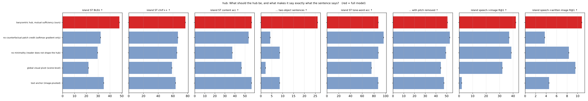
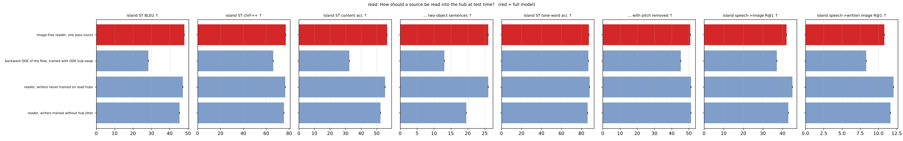
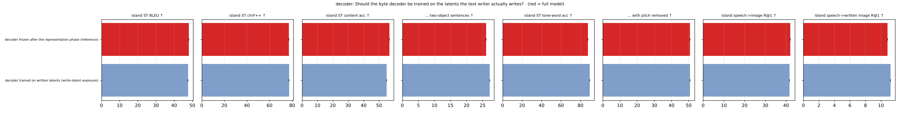

# Ablation study: sf

Dataset `synthworld`, seeds [0].  Every number is measured on the test split, through the hub, with no image and no text of the island language at test time.

### hub: What should the hub be, and what makes it say exactly what the sentence says?

_1 seed(s); test split; mean; bold = best in column (arrows give the direction)._

| variant | island ST BLEU ↑ | island ST chrF++ ↑ | island ST content acc ↑ |   ... two-object sentences ↑ | island ST tone-word acc ↑ |   ... with pitch removed ↑ | island speech->image R@1 ↑ | island speech->written image R@1 ↑ | hub ASR content acc ↑ | hub ASR WER ↓ | captioning BLEU (multi-ref) ↑ | MT hub->written content acc ↑ | MT hub->written BLEU ↑ | MT written->hub BLEU ↑ | text->written image R@1 ↑ | TTS into island (round-trip BLEU) ↑ | TTS into island (round-trip content) ↑ | text read+write, two-object sentences ↑ | both objects covered (text) ↑ | both objects covered (island speech) ↑ | slots on unmentioned objects (text) ↓ | gate (island) ↑ | gate (hub lang) ↓ |
|---|---|---|---|---|---|---|---|---|---|---|---|---|---|---|---|---|---|---|---|---|---|---|---|
| barycentric hub, mutual sufficiency (ours) | **48.06** | **77.05** | **56.67** | **26.09** | 87.50 | 50.83 | **42.08** | **10.83** | 75.42 | 13.49 | 23.06 | **76.67** | **66.76** | **79.91** | **13.33** | 14.40 | 36.67 | 67.39 | 92.39 | 59.78 | 7.29 | 0.87 | 0.01 |
| no counterfactual patch credit (softmax gradient only) | 32.20 | 66.77 | 53.75 | 4.35 | **96.67** | **52.92** | 37.08 | 3.75 | 63.33 | 31.35 | 17.26 | 66.67 | 49.57 | 63.23 | 10.83 | **18.58** | **39.17** | 23.91 | 35.87 | 8.70 | **0.21** | 0.66 | **0.00** |
| no minimality (reader does not shape the hub) | 29.61 | 65.47 | 37.50 | 8.70 | 87.50 | 49.17 | 38.75 | 8.33 | 74.58 | 16.67 | **36.69** | 74.17 | 61.28 | 76.87 | 12.08 | 12.02 | 31.25 | 42.39 | **100.00** | **67.39** | 20.42 | **0.90** | 0.05 |
| global visual pivot (scene-level) | 21.92 | 58.72 | 46.67 | 2.17 | 75.83 | 44.58 | 32.08 | 9.58 | 43.75 | 45.37 | 7.43 | 50.83 | 35.17 | 41.34 | 10.00 | 7.85 | 15.83 | 22.83 | nan | nan | nan | 0.87 | 0.01 |
| text anchor (image-pivoted) | 34.77 | 63.64 | 56.67 | 8.70 | 87.08 | 47.50 | 2.08 | 4.58 | **75.83** | **11.90** | 36.27 | 60.00 | 37.07 | 33.23 | 5.42 | 18.32 | 30.83 | **83.70** | nan | nan | nan | 0.87 | 0.01 |

Full model best on: island ST BLEU, island ST chrF++, island ST content acc,   ... two-object sentences, island speech->image R@1, island speech->written image R@1, MT hub->written content acc, MT hub->written BLEU, MT written->hub BLEU, text->written image R@1.
Full model not best on: island ST tone-word acc (best: no counterfactual patch credit (softmax gradient only)),   ... with pitch removed (best: no counterfactual patch credit (softmax gradient only)), hub ASR content acc (best: text anchor (image-pivoted)), hub ASR WER (best: text anchor (image-pivoted)), captioning BLEU (multi-ref) (best: no minimality (reader does not shape the hub)), TTS into island (round-trip BLEU) (best: no counterfactual patch credit (softmax gradient only)), TTS into island (round-trip content) (best: no counterfactual patch credit (softmax gradient only)), text read+write, two-object sentences (best: text anchor (image-pivoted)), both objects covered (text) (best: no minimality (reader does not shape the hub)), both objects covered (island speech) (best: no minimality (reader does not shape the hub)), slots on unmentioned objects (text) (best: no counterfactual patch credit (softmax gradient only)), gate (island) (best: no minimality (reader does not shape the hub)), gate (hub lang) (best: no counterfactual patch credit (softmax gradient only)).

### read: How should a source be read into the hub at test time?

_1 seed(s); test split; mean; bold = best in column (arrows give the direction)._

| variant | island ST BLEU ↑ | island ST chrF++ ↑ | island ST content acc ↑ |   ... two-object sentences ↑ | island ST tone-word acc ↑ |   ... with pitch removed ↑ | island speech->image R@1 ↑ | island speech->written image R@1 ↑ | hub ASR content acc ↑ | hub ASR WER ↓ | captioning BLEU (multi-ref) ↑ | MT hub->written content acc ↑ | MT hub->written BLEU ↑ | MT written->hub BLEU ↑ | text->written image R@1 ↑ | TTS into island (round-trip BLEU) ↑ | TTS into island (round-trip content) ↑ | text read+write, two-object sentences ↑ | both objects covered (text) ↑ | both objects covered (island speech) ↑ | slots on unmentioned objects (text) ↓ | gate (island) ↑ | gate (hub lang) ↓ |
|---|---|---|---|---|---|---|---|---|---|---|---|---|---|---|---|---|---|---|---|---|---|---|---|
| image-free reader, one pass (ours) | **48.06** | **77.05** | **56.67** | **26.09** | 87.50 | 50.83 | 42.08 | 10.83 | 75.42 | 13.49 | 23.06 | 76.67 | 66.76 | 79.91 | 13.33 | 14.40 | 36.67 | 67.39 | 92.39 | 59.78 | 7.29 | 0.87 | 0.01 |
| backward ODE of the flow, trained with ODE hub-swap | 28.47 | 66.24 | 32.50 | 13.04 | 87.08 | 45.42 | 37.08 | 8.33 | 60.42 | 26.06 | 21.20 | **81.25** | **74.15** | **85.70** | 10.83 | 8.66 | 29.58 | **91.30** | 92.39 | 59.78 | 7.29 | 0.87 | 0.01 |
| reader, writers never trained on read hubs | 47.19 | 76.69 | 55.42 | 26.09 | **88.33** | **51.25** | **45.00** | **12.08** | **77.50** | **12.17** | **25.60** | 78.33 | 70.09 | 79.68 | 10.83 | 16.09 | 30.83 | 66.30 | 92.39 | 59.78 | 7.29 | 0.87 | 0.01 |
| reader, writers trained without hub jitter | 45.38 | 75.58 | 52.50 | 19.57 | 86.25 | 51.25 | 42.92 | 11.67 | 76.67 | 12.17 | 20.60 | 75.42 | 66.14 | 79.80 | **15.00** | **16.43** | **37.08** | 65.22 | 92.39 | 59.78 | 7.29 | 0.87 | 0.01 |

Full model best on: island ST BLEU, island ST chrF++, island ST content acc,   ... two-object sentences.
Full model not best on: island ST tone-word acc (best: reader, writers never trained on read hubs),   ... with pitch removed (best: reader, writers never trained on read hubs), island speech->image R@1 (best: reader, writers never trained on read hubs), island speech->written image R@1 (best: reader, writers never trained on read hubs), hub ASR content acc (best: reader, writers never trained on read hubs), hub ASR WER (best: reader, writers never trained on read hubs), captioning BLEU (multi-ref) (best: reader, writers never trained on read hubs), MT hub->written content acc (best: backward ODE of the flow, trained with ODE hub-swap), MT hub->written BLEU (best: backward ODE of the flow, trained with ODE hub-swap), MT written->hub BLEU (best: backward ODE of the flow, trained with ODE hub-swap), text->written image R@1 (best: reader, writers trained without hub jitter), TTS into island (round-trip BLEU) (best: reader, writers trained without hub jitter), TTS into island (round-trip content) (best: reader, writers trained without hub jitter), text read+write, two-object sentences (best: backward ODE of the flow, trained with ODE hub-swap).

### decoder: Should the byte decoder be trained on the latents the text writer actually writes?

_1 seed(s); test split; mean; bold = best in column (arrows give the direction)._

| variant | island ST BLEU ↑ | island ST chrF++ ↑ | island ST content acc ↑ |   ... two-object sentences ↑ | island ST tone-word acc ↑ |   ... with pitch removed ↑ | island speech->image R@1 ↑ | island speech->written image R@1 ↑ | hub ASR content acc ↑ | hub ASR WER ↓ | captioning BLEU (multi-ref) ↑ | MT hub->written content acc ↑ | MT hub->written BLEU ↑ | MT written->hub BLEU ↑ | text->written image R@1 ↑ | TTS into island (round-trip BLEU) ↑ | TTS into island (round-trip content) ↑ | text read+write, two-object sentences ↑ | both objects covered (text) ↑ | both objects covered (island speech) ↑ | slots on unmentioned objects (text) ↓ | gate (island) ↑ | gate (hub lang) ↓ |
|---|---|---|---|---|---|---|---|---|---|---|---|---|---|---|---|---|---|---|---|---|---|---|---|
| decoder frozen after the representation phase (reference) | **48.06** | 77.05 | **56.67** | 26.09 | 87.50 | 50.83 | **42.08** | 10.83 | 75.42 | 13.49 | **23.06** | 76.67 | 66.76 | 79.91 | **13.33** | 14.40 | **36.67** | 67.39 | 92.39 | 59.78 | 7.29 | 0.87 | 0.01 |
| decoder trained on written latents (write-latent exposure) | 47.65 | **77.28** | 55.00 | **27.17** | **89.58** | 50.83 | 41.67 | **11.25** | **82.92** | **8.60** | 22.34 | **92.08** | **91.26** | **91.20** | 9.58 | **17.72** | 36.25 | **89.13** | 92.39 | 59.78 | 7.29 | 0.87 | 0.01 |

Full model best on: island ST BLEU, island ST content acc, island speech->image R@1, captioning BLEU (multi-ref), text->written image R@1, TTS into island (round-trip content).
Full model not best on: island ST chrF++ (best: decoder trained on written latents (write-latent exposure)),   ... two-object sentences (best: decoder trained on written latents (write-latent exposure)), island ST tone-word acc (best: decoder trained on written latents (write-latent exposure)), island speech->written image R@1 (best: decoder trained on written latents (write-latent exposure)), hub ASR content acc (best: decoder trained on written latents (write-latent exposure)), hub ASR WER (best: decoder trained on written latents (write-latent exposure)), MT hub->written content acc (best: decoder trained on written latents (write-latent exposure)), MT hub->written BLEU (best: decoder trained on written latents (write-latent exposure)), MT written->hub BLEU (best: decoder trained on written latents (write-latent exposure)), TTS into island (round-trip BLEU) (best: decoder trained on written latents (write-latent exposure)), text read+write, two-object sentences (best: decoder trained on written latents (write-latent exposure)).

### island: What should be done with the unpaired speech of the island language?

_1 seed(s); test split; mean; bold = best in column (arrows give the direction)._

| variant | island ST BLEU ↑ | island ST chrF++ ↑ | island ST content acc ↑ |   ... two-object sentences ↑ | island ST tone-word acc ↑ |   ... with pitch removed ↑ | island speech->image R@1 ↑ | island speech->written image R@1 ↑ | hub ASR content acc ↑ | hub ASR WER ↓ | captioning BLEU (multi-ref) ↑ | MT hub->written content acc ↑ | MT hub->written BLEU ↑ | MT written->hub BLEU ↑ | text->written image R@1 ↑ | TTS into island (round-trip BLEU) ↑ | TTS into island (round-trip content) ↑ | text read+write, two-object sentences ↑ | both objects covered (text) ↑ | both objects covered (island speech) ↑ | slots on unmentioned objects (text) ↓ | gate (island) ↑ | gate (hub lang) ↓ |
|---|---|---|---|---|---|---|---|---|---|---|---|---|---|---|---|---|---|---|---|---|---|---|---|
| hub-space back-translation, transport-rectified (ours) | **48.06** | **77.05** | 56.67 | **26.09** | 87.50 | 50.83 | 42.08 | **10.83** | 75.42 | 13.49 | 23.06 | 76.67 | 66.76 | 79.91 | **13.33** | 14.40 | 36.67 | 67.39 | 92.39 | 59.78 | 7.29 | 0.87 | 0.01 |
| back-translation without the relay to the text writers | 42.50 | 75.52 | 48.75 | 23.91 | 87.92 | **51.67** | **42.92** | 10.42 | **77.92** | **11.38** | 28.13 | 77.08 | 67.36 | **83.17** | 12.50 | 15.53 | 35.83 | 71.74 | 92.39 | 59.78 | 7.29 | 0.87 | 0.01 |
| back-translation without the transport step | 47.93 | 75.97 | **58.75** | 25.00 | 86.67 | 48.33 | 40.42 | 10.00 | 76.25 | 12.57 | 25.39 | **77.50** | 67.97 | 78.82 | 12.08 | **17.16** | **40.83** | 67.39 | 92.39 | 59.78 | 7.29 | 0.87 | 0.01 |
| bridge pairs only (unpaired speech unused in phase B) | 35.51 | 71.01 | 40.42 | 19.57 | **88.75** | 47.92 | 40.42 | 7.92 | 77.08 | 13.23 | **33.07** | 77.50 | **69.28** | 82.37 | 12.08 | 11.29 | 25.83 | **73.91** | 92.39 | 59.78 | 7.29 | 0.87 | 0.01 |

Full model best on: island ST BLEU, island ST chrF++,   ... two-object sentences, island speech->written image R@1, text->written image R@1.
Full model not best on: island ST content acc (best: back-translation without the transport step), island ST tone-word acc (best: bridge pairs only (unpaired speech unused in phase B)),   ... with pitch removed (best: back-translation without the relay to the text writers), island speech->image R@1 (best: back-translation without the relay to the text writers), hub ASR content acc (best: back-translation without the relay to the text writers), hub ASR WER (best: back-translation without the relay to the text writers), captioning BLEU (multi-ref) (best: bridge pairs only (unpaired speech unused in phase B)), MT hub->written content acc (best: back-translation without the transport step), MT hub->written BLEU (best: bridge pairs only (unpaired speech unused in phase B)), MT written->hub BLEU (best: back-translation without the relay to the text writers), TTS into island (round-trip BLEU) (best: back-translation without the transport step), TTS into island (round-trip content) (best: back-translation without the transport step), text read+write, two-object sentences (best: bridge pairs only (unpaired speech unused in phase B)).

### tone: Does lexical tone need its own gated path into the hub?

_1 seed(s); test split; mean; bold = best in column (arrows give the direction)._

| variant | island ST BLEU ↑ | island ST chrF++ ↑ | island ST content acc ↑ |   ... two-object sentences ↑ | island ST tone-word acc ↑ |   ... with pitch removed ↑ | island speech->image R@1 ↑ | island speech->written image R@1 ↑ | hub ASR content acc ↑ | hub ASR WER ↓ | captioning BLEU (multi-ref) ↑ | MT hub->written content acc ↑ | MT hub->written BLEU ↑ | MT written->hub BLEU ↑ | text->written image R@1 ↑ | TTS into island (round-trip BLEU) ↑ | TTS into island (round-trip content) ↑ | text read+write, two-object sentences ↑ | both objects covered (text) ↑ | both objects covered (island speech) ↑ | slots on unmentioned objects (text) ↓ | gate (island) ↑ | gate (hub lang) ↓ |
|---|---|---|---|---|---|---|---|---|---|---|---|---|---|---|---|---|---|---|---|---|---|---|---|
| gated tone stream (ours) | **48.06** | **77.05** | **56.67** | **26.09** | **87.50** | 50.83 | **42.08** | **10.83** | **75.42** | **13.49** | 23.06 | **76.67** | **66.76** | **79.91** | **13.33** | 14.40 | 36.67 | **67.39** | 92.39 | **59.78** | 7.29 | **0.87** | 0.01 |
| no tone stream (single stream) | 35.09 | 65.77 | 43.33 | 10.87 | 73.33 | **73.33** | 32.50 | 8.33 | 71.67 | 15.08 | **27.98** | 68.75 | 51.22 | 69.16 | 11.67 | **18.30** | **39.58** | 57.61 | **95.65** | 44.57 | 7.29 | 0.00 | **0.00** |

Full model best on: island ST BLEU, island ST chrF++, island ST content acc,   ... two-object sentences, island ST tone-word acc, island speech->image R@1, island speech->written image R@1, hub ASR content acc, hub ASR WER, MT hub->written content acc, MT hub->written BLEU, MT written->hub BLEU, text->written image R@1, text read+write, two-object sentences, both objects covered (island speech), gate (island).
Full model not best on:   ... with pitch removed (best: no tone stream (single stream)), captioning BLEU (multi-ref) (best: no tone stream (single stream)), TTS into island (round-trip BLEU) (best: no tone stream (single stream)), TTS into island (round-trip content) (best: no tone stream (single stream)), both objects covered (text) (best: no tone stream (single stream)), gate (hub lang) (best: no tone stream (single stream)).

