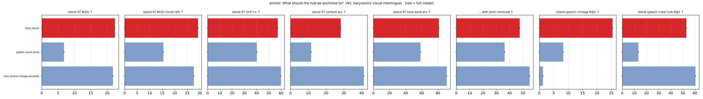
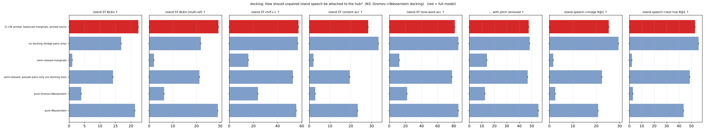
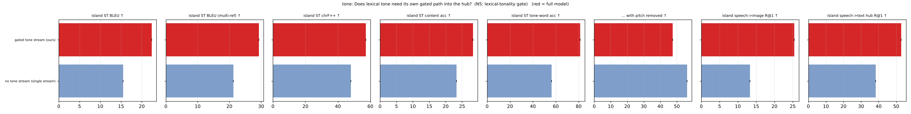
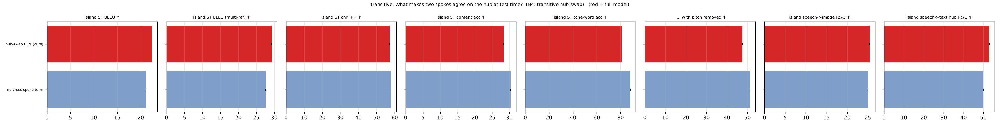
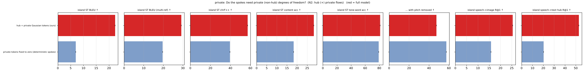

# Ablation study: sf

Dataset `synthworld`, seeds [0].  Every number is measured on the test split, through the hub, with no image and no text of the island language at test time.

### anchor: What should the hub be anchored to?  (N1: barycentric visual interlingua)

_1 seed(s); test split; mean; bold = best in column (arrows give the direction)._

| variant | island ST BLEU ↑ | island ST BLEU (multi-ref) ↑ | island ST chrF++ ↑ | island ST content acc ↑ | island ST tone-word acc ↑ |   ... with pitch removed ↑ | island speech->image R@1 ↑ | island speech->text hub R@1 ↑ | hub ASR WER ↓ | captioning BLEU (multi-ref) ↑ | MT hub->written BLEU ↑ | MT written->hub BLEU ↑ | TTS into island (round-trip BLEU) ↑ | TTS into island (round-trip content) ↑ | text codec CER (written lang) ↓ | gate (island) ↑ | gate (hub lang) ↓ | tone reliance (island) ↑ |
|---|---|---|---|---|---|---|---|---|---|---|---|---|---|---|---|---|---|---|
| bary (ours) | **22.41** | **29.29** | 57.27 | 28.33 | 81.25 | 47.50 | **25.42** | 52.92 | 35.58 | 25.79 | **43.06** | **51.02** | 10.43 | 15.00 | 11.62 | 0.58 | 0.00 | 0.29 |
| global visual pivot | 6.80 | 15.53 | 40.28 | 11.67 | 58.33 | 36.25 | 8.33 | 13.33 | 51.32 | 11.30 | 27.77 | 37.29 | 4.51 | 2.50 | 11.62 | 0.58 | 0.00 | **0.31** |
| text anchor (image-pivoted) | 21.75 | 27.63 | **59.79** | **41.25** | **90.83** | **55.00** | 1.25 | **60.42** | **30.16** | **30.35** | 13.81 | 28.58 | **16.07** | **18.75** | 11.62 | 0.58 | 0.00 | 0.24 |

Full model best on: island ST BLEU, island ST BLEU (multi-ref), island speech->image R@1, MT hub->written BLEU, MT written->hub BLEU.
Full model not best on: island ST chrF++ (best: text anchor (image-pivoted)), island ST content acc (best: text anchor (image-pivoted)), island ST tone-word acc (best: text anchor (image-pivoted)),   ... with pitch removed (best: text anchor (image-pivoted)), island speech->text hub R@1 (best: text anchor (image-pivoted)), hub ASR WER (best: text anchor (image-pivoted)), captioning BLEU (multi-ref) (best: text anchor (image-pivoted)), TTS into island (round-trip BLEU) (best: text anchor (image-pivoted)), TTS into island (round-trip content) (best: text anchor (image-pivoted)), tone reliance (island) (best: global visual pivot).

### docking: How should unpaired island speech be attached to the hub?  (N3: Gromov->Wasserstein docking)

_1 seed(s); test split; mean; bold = best in column (arrows give the direction)._

| variant | island ST BLEU ↑ | island ST BLEU (multi-ref) ↑ | island ST chrF++ ↑ | island ST content acc ↑ | island ST tone-word acc ↑ |   ... with pitch removed ↑ | island speech->image R@1 ↑ | island speech->text hub R@1 ↑ | hub ASR WER ↓ | captioning BLEU (multi-ref) ↑ | MT hub->written BLEU ↑ | MT written->hub BLEU ↑ | TTS into island (round-trip BLEU) ↑ | TTS into island (round-trip content) ↑ | text codec CER (written lang) ↓ | gate (island) ↑ | gate (hub lang) ↓ | tone reliance (island) ↑ |
|---|---|---|---|---|---|---|---|---|---|---|---|---|---|---|---|---|---|---|
| G->W anneal, balanced marginals, pinned (ours) | **22.41** | **29.29** | **57.27** | 28.33 | 81.25 | 47.50 | 25.42 | 52.92 | **35.58** | 25.79 | 43.06 | **51.02** | **10.43** | 15.00 | 11.62 | 0.58 | 0.00 | 0.29 |
| no docking (bridge pairs only) | 16.87 | 21.83 | 56.89 | **33.33** | **85.83** | 48.33 | **29.58** | **55.83** | 37.30 | 22.36 | 41.39 | 49.18 | 9.60 | **29.17** | 11.62 | 0.58 | 0.00 | 0.32 |
| semi-relaxed marginals | 1.02 | 2.01 | 15.88 | 2.08 | 12.50 | 14.17 | 1.67 | 2.08 | 45.63 | 25.02 | 41.81 | 44.84 | 1.40 | 2.08 | 11.62 | 0.58 | 0.00 | 0.41 |
| semi-relaxed, pseudo-pairs only (no docking loss) | 14.23 | 21.28 | 52.66 | 19.58 | 77.92 | 46.67 | 22.50 | 48.75 | 37.96 | **26.59** | **44.05** | 48.74 | 7.58 | 8.33 | 11.62 | 0.58 | 0.00 | 0.36 |
| pure Gromov-Wasserstein | 3.91 | 6.36 | 23.78 | 2.92 | 22.08 | 12.50 | 2.50 | 2.92 | 38.49 | 25.86 | 41.65 | 45.27 | 2.08 | 1.67 | 11.62 | 0.58 | 0.00 | **0.46** |
| pure Wasserstein | 21.34 | 29.01 | 55.59 | 23.33 | 85.83 | **55.42** | 20.83 | 43.75 | 38.36 | 25.25 | 43.73 | 49.54 | 6.64 | 9.58 | 11.62 | 0.58 | 0.00 | 0.26 |

Full model best on: island ST BLEU, island ST BLEU (multi-ref), island ST chrF++, hub ASR WER, MT written->hub BLEU, TTS into island (round-trip BLEU).
Full model not best on: island ST content acc (best: no docking (bridge pairs only)), island ST tone-word acc (best: no docking (bridge pairs only)),   ... with pitch removed (best: pure Wasserstein), island speech->image R@1 (best: no docking (bridge pairs only)), island speech->text hub R@1 (best: no docking (bridge pairs only)), captioning BLEU (multi-ref) (best: semi-relaxed, pseudo-pairs only (no docking loss)), MT hub->written BLEU (best: semi-relaxed, pseudo-pairs only (no docking loss)), TTS into island (round-trip content) (best: no docking (bridge pairs only)), tone reliance (island) (best: pure Gromov-Wasserstein).

### tone: Does lexical tone need its own gated path into the hub?  (N5: lexical-tonality gate)

_1 seed(s); test split; mean; bold = best in column (arrows give the direction)._

| variant | island ST BLEU ↑ | island ST BLEU (multi-ref) ↑ | island ST chrF++ ↑ | island ST content acc ↑ | island ST tone-word acc ↑ |   ... with pitch removed ↑ | island speech->image R@1 ↑ | island speech->text hub R@1 ↑ | hub ASR WER ↓ | captioning BLEU (multi-ref) ↑ | MT hub->written BLEU ↑ | MT written->hub BLEU ↑ | TTS into island (round-trip BLEU) ↑ | TTS into island (round-trip content) ↑ | text codec CER (written lang) ↓ | gate (island) ↑ | gate (hub lang) ↓ | tone reliance (island) ↑ |
|---|---|---|---|---|---|---|---|---|---|---|---|---|---|---|---|---|---|---|
| gated tone stream (ours) | **22.41** | **29.29** | **57.27** | **28.33** | **81.25** | 47.50 | **25.42** | **52.92** | **35.58** | **25.79** | 43.06 | **51.02** | **10.43** | **15.00** | 11.62 | **0.58** | 0.00 | **0.29** |
| no tone stream (single stream) | 15.49 | 21.32 | 48.08 | 23.33 | 56.25 | **56.25** | 13.33 | 38.33 | 36.77 | 19.05 | **43.30** | 46.15 | 4.27 | 11.67 | **11.59** | 0.00 | **0.00** | 0.00 |

Full model best on: island ST BLEU, island ST BLEU (multi-ref), island ST chrF++, island ST content acc, island ST tone-word acc, island speech->image R@1, island speech->text hub R@1, hub ASR WER, captioning BLEU (multi-ref), MT written->hub BLEU, TTS into island (round-trip BLEU), TTS into island (round-trip content), gate (island), tone reliance (island).
Full model not best on:   ... with pitch removed (best: no tone stream (single stream)), MT hub->written BLEU (best: no tone stream (single stream)), text codec CER (written lang) (best: no tone stream (single stream)), gate (hub lang) (best: no tone stream (single stream)).

### transitive: What makes two spokes agree on the hub at test time?  (N4: transitive hub-swap)

_1 seed(s); test split; mean; bold = best in column (arrows give the direction)._

| variant | island ST BLEU ↑ | island ST BLEU (multi-ref) ↑ | island ST chrF++ ↑ | island ST content acc ↑ | island ST tone-word acc ↑ |   ... with pitch removed ↑ | island speech->image R@1 ↑ | island speech->text hub R@1 ↑ | hub ASR WER ↓ | captioning BLEU (multi-ref) ↑ | MT hub->written BLEU ↑ | MT written->hub BLEU ↑ | TTS into island (round-trip BLEU) ↑ | TTS into island (round-trip content) ↑ | text codec CER (written lang) ↓ | gate (island) ↑ | gate (hub lang) ↓ | tone reliance (island) ↑ |
|---|---|---|---|---|---|---|---|---|---|---|---|---|---|---|---|---|---|---|
| hub-swap CFM (ours) | **22.41** | **29.29** | 57.27 | 28.33 | 81.25 | 47.50 | **25.42** | **52.92** | **35.58** | 25.79 | 43.06 | **51.02** | **10.43** | **15.00** | 11.62 | 0.58 | 0.00 | 0.29 |
| no cross-spoke term | 21.08 | 27.61 | **58.13** | **30.42** | **88.33** | **51.25** | 25.00 | 50.00 | 53.44 | **30.02** | **48.68** | 48.58 | 5.19 | 10.42 | 11.62 | 0.58 | 0.00 | **0.31** |

Full model best on: island ST BLEU, island ST BLEU (multi-ref), island speech->image R@1, island speech->text hub R@1, hub ASR WER, MT written->hub BLEU, TTS into island (round-trip BLEU), TTS into island (round-trip content).
Full model not best on: island ST chrF++ (best: no cross-spoke term), island ST content acc (best: no cross-spoke term), island ST tone-word acc (best: no cross-spoke term),   ... with pitch removed (best: no cross-spoke term), captioning BLEU (multi-ref) (best: no cross-spoke term), MT hub->written BLEU (best: no cross-spoke term), tone reliance (island) (best: no cross-spoke term).

### private: Do the spokes need private (non-hub) degrees of freedom?  (N2: hub (+) private flows)

_1 seed(s); test split; mean; bold = best in column (arrows give the direction)._

| variant | island ST BLEU ↑ | island ST BLEU (multi-ref) ↑ | island ST chrF++ ↑ | island ST content acc ↑ | island ST tone-word acc ↑ |   ... with pitch removed ↑ | island speech->image R@1 ↑ | island speech->text hub R@1 ↑ | hub ASR WER ↓ | captioning BLEU (multi-ref) ↑ | MT hub->written BLEU ↑ | MT written->hub BLEU ↑ | TTS into island (round-trip BLEU) ↑ | TTS into island (round-trip content) ↑ | text codec CER (written lang) ↓ | gate (island) ↑ | gate (hub lang) ↓ | tone reliance (island) ↑ |
|---|---|---|---|---|---|---|---|---|---|---|---|---|---|---|---|---|---|---|
| hub + private Gaussian tokens (ours) | **22.41** | **29.29** | **57.27** | **28.33** | **81.25** | 47.50 | **25.42** | **52.92** | **35.58** | **25.79** | **43.06** | **51.02** | **10.43** | **15.00** | 11.62 | 0.58 | 0.00 | 0.29 |
| private tokens fixed to zero (deterministic spokes) | 7.01 | 19.69 | 39.57 | 18.33 | 79.17 | **57.50** | 15.83 | 20.42 | 64.95 | 10.54 | 8.54 | 14.77 | 5.20 | 3.33 | 11.62 | 0.58 | 0.00 | **0.40** |

Full model best on: island ST BLEU, island ST BLEU (multi-ref), island ST chrF++, island ST content acc, island ST tone-word acc, island speech->image R@1, island speech->text hub R@1, hub ASR WER, captioning BLEU (multi-ref), MT hub->written BLEU, MT written->hub BLEU, TTS into island (round-trip BLEU), TTS into island (round-trip content).
Full model not best on:   ... with pitch removed (best: private tokens fixed to zero (deterministic spokes)), tone reliance (island) (best: private tokens fixed to zero (deterministic spokes)).

